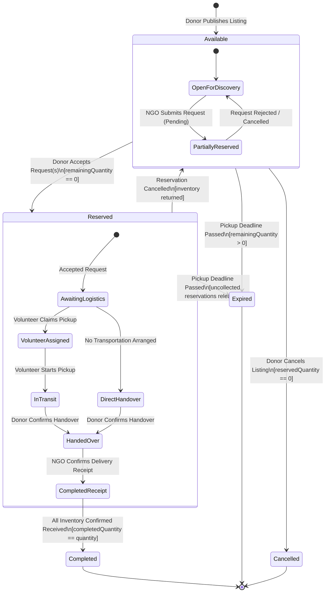
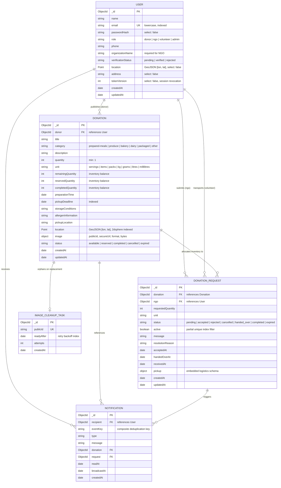

<div id="top"></div>

<div align="center">


# FoodBridge — Surplus Food Redistribution Platform

**Transactional Resource Allocation, Geospatial Matching & Logistics Coordination for Zero Food Waste.**  
_Bridging High-Volume Food Donors, Verified NGOs, and On-Demand Volunteer Couriers._

<br />

[](https://food-bridge-2jwl.vercel.app)
[](https://foodbridge-u7qa.onrender.com/api/health/ready)
[](https://nodejs.org/)
[](https://expressjs.com/)
[](https://react.dev/)
[](https://vitejs.dev/)
[](https://tailwindcss.com/)
[](https://www.mongodb.com/atlas)
[](https://socket.io/)
[](https://cloudinary.com/)
[](https://vitest.dev/)

<br />

> 🌐 **Live Web Application**: **[food-bridge-2jwl.vercel.app](https://food-bridge-2jwl.vercel.app/)**  
> ⚡ **Persistent Backend API**: Health and readiness verified at **[`foodbridge-u7qa.onrender.com/api/health/ready`](https://foodbridge-u7qa.onrender.com/api/health/ready)**  
> 📦 **GitHub Repository**: **[github.com/CodedStars-hub/FoodBridge](https://github.com/CodedStars-hub/FoodBridge)**

<br />

[Live Application](https://food-bridge-2jwl.vercel.app) · [Backend Health](https://foodbridge-u7qa.onrender.com/api/health/ready) · [Problem & Vision](#problem--vision) · [Why FoodBridge](#why-foodbridge) · [Core Application Modules](#core-application-modules) · [Donation Lifecycle & Workflow Engine](#donation-lifecycle--workflow-engine) · [System Architecture](#system-architecture) · [Backend Engineering & Design](#backend-engineering--design) · [Database Design](#database-design) · [API Reference](#api-reference) · [Real-Time Communication](#real-time-communication) · [Security & Reliability](#security--reliability) · [Technology Stack](#technology-stack) · [Project Structure](#project-structure) · [Local Development](#local-development) · [Testing & Quality Assurance](#testing--quality-assurance) · [Deployment Architecture](#deployment-architecture) · [Roadmap](#roadmap)

</div>

---

<div align="center">
  <h2>Problem & Vision</h2>
</div>

Institutional food waste occurs at an unprecedented scale across commercial kitchens, college cafeterias, banquet halls, restaurants, and grocery distributors. While millions experience chronic nutritional insecurity, massive volumes of wholesome, edible prepared meals and fresh produce are discarded daily due to **severe structural inefficiencies in last-mile recovery and distribution**.

Traditional surplus food donation attempts collapse under five critical operational bottlenecks:

### 1. The Perishability & Time-Window Trap

Prepared meals have rigid microbiological shelf-life constraints governed by strict preparation timestamps and ambient temperature decay. A delay of two to four hours between kitchen overproduction and consumption can turn safe food into hazardous biological waste. Without real-time publishing, instant notifications, and hard automated deadline invalidation, food expires before prospective beneficiaries even learn of its availability.

### 2. Information Asymmetry & The "Cold Call" Dilemma

Donors (e.g., catering managers, university cafeteria directors) have neither the time nor the roster to cold-call local charities when a 100-serving surplus emerges at 9:00 PM. Conversely, non-governmental organizations (NGOs) and community shelters operate with unpredictable beneficiary loads, lacking visibility into where food is located, whether storage requirements (refrigerated, dry, hot-holding) match their capacity, or how allergens are cataloged.

### 3. Inventory Over-Allocation & Race Conditions

Informal communication (such as WhatsApp groups, telephone outreach, or ad-hoc spreadsheets) lacks transactional concurrency control. When a donor announces 50 meals in a group chat, multiple shelters may dispatch vehicles simultaneously. One shelter arrives to find the food already claimed, wasting precious fuel and volunteer hours, while another shelter goes unassisted.

### 4. Last-Mile Logistics & The Transportation Chasm

Donors cannot dedicate staff to deliver surplus items; grassroots NGOs often lack dedicated transport vans. Bridging this gap requires **on-demand volunteer couriers**. However, routing volunteers requires verified pickup coordinates, secure handoff protocols, real-time status transitions, and automated cancellation fallbacks when volunteers cancel or fail to arrive before the food's pickup deadline.

### 5. Accountability, Safety & Traceability Deficits

Food recovery requires rigorous custody tracking. Donors must be protected from liability by enforcing verified NGO identities, strict packaging guidelines, allergen disclosures, and tamper-resistant digital handoff acknowledgments. Public health standards demand that food cannot simply be handed off anonymously.

### The FoodBridge Vision

**FoodBridge** replaces chaotic ad-hoc communication with a **deterministic, transactional redistribution engine**. Engineered as a high-integrity MERN-stack platform, FoodBridge provides:

1. **ACID Transactional Reservations**: MongoDB replica-set snapshot transactions that eliminate over-allocation, phantom claims, and duplicate requests.
2. **Explainable Geospatial Matching**: Multi-criteria spherical ranking combining haversine distance, volume match ratio, and time-to-expiry urgency.
3. **Multi-Leg Logistics State Machine**: A structured courier lifecycle with immutable audit events connecting donors, volunteers, and NGOs.
4. **Instant Invalidation & State Sync**: Socket.IO push notifications synchronized with durable database outboxes for real-time collaboration.
5. **Role-Scoped, Unit-Pure Analytics**: Defensible reporting that refuses to combine incongruent units (servings vs. kilograms), providing transparent recovery statistics.

---

<div align="center">
  <h2>Why FoodBridge</h2>
</div>

FoodBridge bridges the chasm between raw intent and operational execution. The platform replaces informal, fragile communication channels with verified, transactional engineering:

| Architectural Dimension    | Informal Coordination (WhatsApp / Phone)                       | Manual Spreadsheets (Google Sheets / Excel)                 | FoodBridge Platform Engine                                                                    |
| :------------------------- | :------------------------------------------------------------- | :---------------------------------------------------------- | :-------------------------------------------------------------------------------------------- |
| **Inventory Allocation**   | ❌ Race conditions; double-booking and wasted trips            | ⚠️ Delayed manual reconciliation; prone to human error      | ✅ **ACID MongoDB snapshot transactions with atomic inventory decrements**                    |
| **Geospatial Discovery**   | ❌ None; static text addresses shared without distance metrics | ❌ Static rows; no geospatial indexing or proximity filters | ✅ **Spherical `$geoNear` 2dsphere indexing with explainable multi-factor scoring**           |
| **Identity & Trust**       | ❌ Unverified phone numbers; zero role boundaries              | ❌ Flat document permissions; no cryptographic assurance    | ✅ **Strict Role-Based Access Control (RBAC) with verified organization statuses**            |
| **State Transitions**      | ❌ Unenforced; verbal agreements with zero tracking            | ❌ Manual cell edits; zero validation of prerequisite steps | ✅ **Deterministic state machines enforcing strict sequential handovers & receipts**          |
| **Logistics Coordination** | ❌ Ad-hoc, untracked volunteer dispatch                        | ❌ Disconnected from real-time vehicle or pickup status     | ✅ **Integrated volunteer dispatch lifecycle with audit logs, claims, and arrival tracking**  |
| **Real-Time Notification** | ❌ Noisy group chats; critical alerts buried in chatter        | ❌ Static data; zero push mechanism                         | ✅ **Socket.IO room-isolated sync hints backed by durable database inbox tracking**           |
| **Perishability Defense**  | ❌ Expired food discovered upon physical arrival               | ❌ Static deadlines with no automated status revocation     | ✅ **Automated deadline enforcement with transactionally cascaded reservation expiry**        |
| **Security Architecture**  | ❌ Unencrypted plain-text communication                        | ❌ Public or shared links with broad credential leakage     | ✅ **HttpOnly `__Host-` cookies, JWT session versioning, origin checks, and CSRF protection** |
| **Data Integrity**         | ❌ Zero metrics or audits                                      | ⚠️ Incongruent sum formulas (adding kg and meals together)  | ✅ **Unit-pure aggregation; food counted strictly upon verified recipient receipt**           |

---

<div align="center">
  <h2>Core Application Modules</h2>
</div>

FoodBridge is structured into cohesive, role-tailored modules serving Donors, NGOs, Volunteers, and Platform Administrators:

```
┌────────────────────────────────────────────────────────────────────────────────────────┐
│                                FOODBRIDGE SYSTEM MODULES                               │
├──────────────────────┬──────────────────────┬────────────────────┬─────────────────────┤
│   DONOR WORKSPACE    │    NGO DISCOVERY     │ VOLUNTEER COURIER  │  ADMINISTRATION &   │
│  • Food Publishing   │  • Map & List Geo    │  • Available Tasks │     MODERATION      │
│  • Inventory Locks   │  • Explainable Match │  • Claim & Routing │  • Identity Audit   │
│  • Managed Images    │  • Reserve Batches   │  • En Route/Arrive │  • Fleet Metrics    │
│  • Donor Handover    │  • Transport Setup   │  • Issue Reporting │  • Unit Analytics   │
└──────────────────────┴──────────────────────┴────────────────────┴─────────────────────┘
```

### 1. Donor Workspace & Inventory Management

- **Problem Solved**: Commercial kitchens and cafeterias require a rapid, frictionless interface to publish surplus batches with exact allergen disclosures, storage prerequisites, and physical collection coordinates.
- **User Interaction**: Donors manage food listings via `/dashboard/donor/donations`, create new offerings via `/dashboard/donor/donations/new`, upload food imagery, review incoming reservation requests, and initiate physical handovers.
- **Backend Processing**: Handled by `donationController.js` and `donationWorkflow.js`. Listings enforce strict invariant validations (`pickupDeadline > preparationTime`, positive integer quantities). Edits are locked as soon as active reservation requests exist.
- **Data Stored**: `Donation` collection records containing `quantity`, `remainingQuantity`, `reservedQuantity`, `completedQuantity`, `category`, `unit`, `storageConditions`, `allergenInformation`, GeoJSON `location`, and Cloudinary image metadata.
- **Security & Validation Rules**: Restriced strictly to authenticated users with `role: 'donor'`. Mutation operations enforce document ownership (`donation.donor === req.user._id`). Request bodies are validated using Zod strict schemas rejecting unrecognized attributes.

### 2. NGO Geospatial Discovery & Explainable Matching

- **Problem Solved**: Grassroots relief organizations require immediate visibility into nearby available surplus batches sorted by logistical viability and volume fulfillment.
- **User Interaction**: Verified NGOs browse the interactive Leaflet map and list views via `/dashboard/ngo/nearby` and `/dashboard/ngo/recommended`. NGOs can adjust search radius (1–100 km), filter by category, and specify desired batch quantities.
- **Backend Processing**: Executed by `discoveryService.js`. Executes a MongoDB `$geoNear` aggregation pipeline over the `2dsphere` spatial index on `location`. When running in ranked mode, the service computes a deterministic, explainable multi-component score:
  $$\text{Score} = w_{\text{dist}} \cdot C_{\text{dist}} + w_{\text{qty}} \cdot C_{\text{qty}} + w_{\text{time}} \cdot C_{\text{time}}$$
  Where components represent:
  - **Distance Component ($C\_{\text{dist}}$)**: $100 \times \max\left(0, 1 - \frac{\text{distanceKm}}{\text{radiusKm}}\right)$ (Default weight: 40%)
  - **Quantity Component ($C\_{\text{qty}}$)**: $100 \times \min\left(1.0, \frac{\text{requestedQty}}{\text{availableQty}}\right)$ (Default weight: 35%)
  - **Pickup Window Component ($C\_{\text{time}}$)**: $100 \times \max\left(0, \min\left(1.0, \frac{\text{minutesRemaining}}{\text{windowMinutes}}\right)\right)$ (Default weight: 25%)
- **Data Stored**: Geospatial coordinates indexed as 2D sphere points `[longitude, latitude]`. The calculated match breakdown is returned ephemerally in the response payload for complete operator transparency.
- **Security & Validation Rules**: Restricted to `role: 'ngo'`. Profiles must maintain verified coordinates or pass explicit query coordinates within statutory range ($[-180, 180]$ longitude, $[-90, 90]$ latitude).

### 3. NGO Requests & Transactional Reservations

- **Problem Solved**: Eliminating race conditions and over-allocation when multiple charities request allocations from the same surplus listing.
- **User Interaction**: NGOs submit allocation requests via `/dashboard/ngo/explore` or `/dashboard/ngo/requests`, monitor donor decisions, arrange transportation, and confirm physical delivery receipt.
- **Backend Processing**: Managed by `submitRequest` and `transitionRequest` in `donationWorkflow.js`. All state mutations execute inside a **MongoDB snapshot transaction**. When a donor accepts a request, an atomic `findOneAndUpdate` validates available remaining inventory before decrementing `remainingQuantity` and incrementing `reservedQuantity`.
- **Data Stored**: `DonationRequest` documents tracking `requestedQuantity`, `status`, `active: Boolean`, `acceptedAt`, `handedOverAt`, `receivedAt`, and embedded `pickup` records.
- **Security & Validation Rules**: Partial unique index `{ donation: 1, ngo: 1 }` with `{ active: true }` prevents an NGO from opening concurrent active requests for the same listing. Only verified NGOs (`verificationStatus: 'verified'`) may request allocations.

### 4. Volunteer Logistics & Courier State Machine

- **Problem Solved**: Direct physical handover is often impossible when donors and NGOs lack transportation staff. Volunteer couriers require clear routing details and unambiguous task ownership.
- **User Interaction**: Verified volunteers browse unassigned deliveries via `/dashboard/volunteer/pickups/available`, claim tasks, transition status to `en_route_to_pickup`, log arrivals, or report delivery bottlenecks.
- **Backend Processing**: Handled by `pickupWorkflow.js` and `pickupLifecycle.js`. Once an NGO arranges delivery, the system creates an embedded `pickup` subdocument with `origin` (donor collection point) and `destination` (NGO shelter address). Volunteers claim deliveries via an atomic check-and-set query. Physical handovers and final receipts require explicit two-party confirmations.
- **Data Stored**: Embedded `pickup` subdocuments containing `origin`, `destination`, `volunteer` reference, `arrivalReportedAt`, `issue`, and an immutable sequence of audit entries: `events: [{ action, status, actor, at, reason }]`.
- **Security & Validation Rules**: Only verified volunteers may claim pickups. Transportation can only be cancelled prior to physical donor handover. Handover requires an active, verified volunteer assignment; direct donor-to-NGO handovers remain available if transportation is cancelled.

### 5. Persistent Real-Time Notifications

- **Problem Solved**: Donors, NGOs, and volunteers need instant operational alerts without noisy communication channels or reliance on lossy socket payloads.
- **User Interaction**: Users view unread counts in the global application header and interact with their notification inbox at `/dashboard/:role/notifications`.
- **Backend Processing**: Handled by `realtimeService.js` and `notificationService.js`. When lifecycle events occur (e.g., request accepted, pickup claimed, delivery completed), a durable `Notification` document is inserted into MongoDB. The runtime Socket.IO service reconciles connected users every 2 seconds, emitting lightweight `notifications:changed` cache-invalidation hints to recipient rooms. Clients then fetch their authenticated REST inbox.
- **Data Stored**: `Notification` collection storing `recipient`, `eventKey`, `type`, `message`, `readAt`, and `broadcastAt`.
- **Security & Validation Rules**: A unique index on `{ recipient: 1, eventKey: 1 }` guarantees zero duplicate notification inserts. Socket connections authenticate via the session cookie during handshake; client-side room joining or arbitrary socket message broadcasts are strictly forbidden.

### 6. Media Pipeline & Orphaned Asset Lifecycle

- **Problem Solved**: Food listings benefit immensely from authentic imagery (packaging inspection, freshness verification), but unmoderated or failed uploads risk security vulnerabilities and orphaned cloud storage bloat.
- **User Interaction**: Donors upload photos directly inside the donation form. Images appear instantly across donor listings and NGO discovery cards.
- **Backend Processing**: Handled by `imageRoutes.js` and `imageService.js`. Multi-stage pipeline:
  1. Multer intercepts the binary stream into memory storage (capped at 5 MB).
  2. Magic-byte verification via `file-type` inspects binary headers to reject disguised executables.
  3. `sharp` decodes and sanitizes the image buffer, stripping EXIF/geolocation metadata and re-encoding to standardized JPEG/PNG/WebP.
  4. Streamed to Cloudinary under folder `foodbridge/donations`.
  5. If an image is updated or a listing is removed, old Cloudinary `publicId` identifiers are scheduled into the `ImageCleanupTask` collection and deleted asynchronously by a durable background worker.
- **Data Stored**: Embedded `image` record in `Donation` (`publicId`, `secureUrl`, `format`, `bytes`, `width`, `height`). Durable retry tasks in `ImageCleanupTask`.
- **Security & Validation Rules**: Rate-limited to 30 uploads per authenticated donor per 15 minutes. Restricted strictly to listing owners. If Cloudinary credentials are absent, the endpoint degrades gracefully with HTTP 503 while leaving all core donation features completely intact.

### 7. Role-Scoped Analytics & Unit-Pure Metrics

- **Problem Solved**: Institutional donors and platform administrators need defensible impact metrics without fabricated statistics or mathematically invalid unit aggregations.
- **User Interaction**: Users access the analytics tab at `/dashboard/:role/analytics`, selecting reporting windows (last 30 days, 90 days, year-to-date, or all-time).
- **Backend Processing**: Executed by `analyticsService.js` using high-performance MongoDB aggregation pipelines. Metrics are segregated by role:
  - **Donor**: Total listings, active listings, completed listings, monthly donation velocity, and unit-segregated totals.
  - **NGO**: Received donations, total volume received segregated strictly by measurement unit, active requests, and fulfillment history.
  - **Volunteer**: Completed pickups, deliveries in progress, total delivery events, and monthly participation trends.
  - **Admin**: System-wide throughput, verification queue distribution, active vs. completed ratios, and user role registrations.
- **Data Stored**: Aggregated dynamically using `$facet`, `$lookup`, and `$group` operations with UTC boundary indexing. Food volume is counted **strictly upon confirmed NGO receipt**.
- **Security & Validation Rules**: Quantities are **never combined across units** (10 kg + 20 servings is never summed to "30 items"). Role routes are strictly gated (`/api/analytics/:role`); cross-role analytical access is rejected with HTTP 403.

---

<div align="center">
  <h2>Donation Lifecycle & Workflow Engine</h2>
</div>

Every donation within FoodBridge traverses a strictly governed, multi-stage finite state machine. State transitions occur exclusively through atomic transactions with complete inventory balance conservation:

$$\text{quantity} \equiv \text{remainingQuantity} + \text{reservedQuantity} + \text{completedQuantity}$$



### Complete State Transition Matrix

#### 1. Donation Listing Statuses

- **`available`**: The listing is active and discoverable. `remainingQuantity > 0` and `pickupDeadline > now`. NGOs can submit allocation requests.
- **`reserved`**: The entirety of the available inventory has been accepted into active reservations (`remainingQuantity === 0`). The listing remains hidden from standard discovery.
- **`completed`**: All items have been physically handed over to and confirmed received by recipient NGOs (`completedQuantity === quantity`). The lifecycle concludes successfully.
- **`cancelled`**: The donor manually revoked the listing before handover. Only permissible if `reservedQuantity === 0`. Any open pending requests are automatically cancelled.
- **`expired`**: The pickup deadline elapsed before full collection. Active uncollected reservations are transactionally released, pending requests are marked expired, and volunteer delivery tasks are cancelled.

#### 2. Request Lifecycle Statuses

- **`pending`**: An NGO has requested an allocation. Available inventory is validated but not yet locked into a confirmed reservation.
- **`accepted`**: The donor accepted the request. The required quantity is atomically transferred from `remainingQuantity` to `reservedQuantity`.
- **`rejected`**: The donor declined the request, or the request was automatically closed because the listing's inventory was exhausted by another recipient.
- **`cancelled`**: Either the requesting NGO cancelled the reservation, or the donor cancelled the entire listing. If the request was `accepted`, inventory is immediately returned to `remainingQuantity`.
- **`handed_over`**: Physical custody of the food has transferred from the donor to either the courier volunteer or directly to the NGO.
- **`completed`**: The NGO confirmed final physical receipt at their distribution shelter. `reservedQuantity` is decremented and `completedQuantity` is incremented.

#### 3. Volunteer Courier Logistics Statuses

- **`awaiting_volunteer`**: The NGO configured transport details; the task is broadcast to the volunteer network.
- **`assigned`**: A verified volunteer claimed the pickup task.
- **`en_route_to_pickup`**: The volunteer initiated transit toward the donor's collection address.
- **`picked_up`**: Donor confirmed physical handover of the batch to the volunteer.
- **`delivered`**: Volunteer reported arrival and delivery at the NGO destination shelter.
- **`cancelled`**: Transportation was cancelled by the donor/NGO prior to physical handover.

---

<div align="center">
  <h2>System Architecture</h2>
</div>

FoodBridge is engineered as a decoupled distributed web system separating static edge presentation from persistent, transactional API execution:

```
+---------------------------------------------------------------------------------------------------------+
|                                    CLIENT BROWSER (React 19 + Vite 7 SPA)                               |
|  - Role Workspaces (Donor, NGO, Volunteer, Admin)         - Interactive Leaflet 2D Map Explorer         |
|  - Recharts Metric & Trend Visualizers                     - Resilient Socket.IO Live Invalidation Sync  |
|  - Strict Client-Side Form & Geometry Validation           - Automated Session Restoration & Retry UX   |
+---------------------------------------------------------------------------------------------------------+
                                                     │
                                                     │ HTTPS / WSS (Cross-Site Credentialed)
                                                     ▼
+---------------------------------------------------------------------------------------------------------+
|                                    VERCEL GLOBAL EDGE NETWORK (CDN)                                     |
|  - Route /*            =====================> High-Performance Static Edge Storage (client/dist)        |
|  - Security Directives =====================> HSTS (1 Yr), X-Frame-Options: DENY, X-Content-Type: nosniff|
|  - Client Routing      =====================> Deterministic SPA Rewrite Rule -> /index.html             |
+---------------------------------------------------------------------------------------------------------+
                                                     │
                                                     │ Direct REST / WebSocket Traffic
                                                     ▼
+---------------------------------------------------------------------------------------------------------+
|                                  RENDER WEB SERVICE (Node.js 24 LTS)                                    |
|  - Long-Lived Single/Multi-Worker Process   - Persistent Express 5.1 HTTP & REST Engine                 |
|  - Socket.IO 4.8 WebSocket Transport Server - 2-Second Periodic Notification Outbox Reconciler          |
|  - 60-Second Orphaned Image Cleanup Worker  - In-Memory / Redis Shared Sliding-Window Rate Limiters     |
|  - Origin Allowlist & CSRF Marker Verifiers - Graceful SIGTERM/SIGINT Process Teardown Lifecycle        |
+---------------------------------------------------------------------------------------------------------+
                         │                                                      │
                         │ Mongoose 8 (Replica Set Pool)                        │ HTTPS Multipart Stream
                         ▼                                                      ▼
+---------------------------------------------------+  +--------------------------------------------------+
|               MONGODB ATLAS CLUSTER               |  |                CLOUDINARY CDN                    |
|  - Replica Set Primary/Secondary Nodes            |  |  - Managed Folder: foodbridge/donations          |
|  - Snapshot-Level Isolation Transactions          |  |  - Automatic WebP/AVIF Transcoding Optimization  |
|  - 2dsphere Geospatial Indexing Engine            |  |  - Sharp Pre-Sanitization & Metadata Stripping   |
|  - Partial Unique Constraint Verification         |  |  - Asynchronous Public-ID Garbage Collection     |
+---------------------------------------------------+  +--------------------------------------------------+
```

### Architectural Tenets & The Render Hosting Rationale

#### 1. Why Render for Backend Instead of Serverless Functions?

While frontend assets deploy naturally to Vercel's global CDN, the FoodBridge backend requires a **persistent Node.js application process** hosted on Render:

- **Persistent Bi-Directional WebSockets**: Socket.IO requires continuous stateful TCP socket handshakes, client-to-room mappings, and low-latency push capability. Serverless function runtimes spin down on idle, terminating WebSocket connections and forcing client reconnect loops.
- **Persistent Connection Pooling**: MongoDB replica set snapshot transactions require persistent, warm connection pools. Serverless invocations suffer cold starts and risk exhausting database connection limits through rapid horizontal container recycling.
- **Durable Background Workers**: FoodBridge executes an in-process notification outbox batch dispatcher every 2,000 ms and an orphaned Cloudinary image garbage-collection timer every 60,000 ms. Serverless functions cannot reliably execute asynchronous background recurring jobs.
- **Sliding-Window Rate Limiting**: Shared in-memory or Redis-backed sliding-window rate limiting requires predictable runtime state that cannot be spoofed by ephemeral container cold boots.

#### 2. Cross-Site Security & Session Decoupling

Because Vercel (`food-bridge-2jwl.vercel.app`) and Render (`foodbridge-u7qa.onrender.com`) operate across distinct domains in production:

- Sessions utilize **`SameSite=None; Secure`** cookies.
- Credentialed CORS is strictly restricted to approved production origins; wildcards (`*`) are disallowed.
- To neutralize cross-site request forgery without session-state race conditions, all state-changing endpoints enforce an exact **`Origin` allowlist check**, **`Content-Type: application/json`**, and a mandatory custom header: **`X-CSRF-Protection: foodbridge`**. Browsers strictly block cross-origin requests from setting custom headers without a preflight CORS approval.

---

<div align="center">
  <h2>Backend Engineering & Design</h2>
</div>

The FoodBridge backend is structured according to clean architectural separation between routing, controllers, domain services, data models, and cross-cutting security middleware:

```
server/src/
├── app.js               # Express application composition, middleware chain, route mounting
├── index.js             # HTTP listener, signal traps (SIGTERM/SIGINT), graceful shutdown
├── runtime.js           # Shared server runtime; wires HTTP, Socket.IO, DB & maintenance jobs
├── config/              # Validated environment schemas, proxy topology, database connections
├── controllers/         # Request decoding, parameter validation, HTTP response projections
├── middleware/          # JWT authentication, RBAC, CSRF defense, rate limits, error boundary
├── models/              # Mongoose schemas, schema pre-hooks, GeoJSON validators, custom indexes
├── routes/              # Express routers defining HTTP verb, path, and middleware guards
├── services/            # Pure business logic, workflow transactions, matching algorithms
├── stores/              # Rate-limit storage adapters (in-memory demo vs. Upstash Redis)
└── utils/               # Structured JSON logger, job runners, custom HttpError definitions
```

### Key Engineering Decisions

#### 1. Deterministic JWT Session Architecture

Instead of storing volatile bearer tokens in client `localStorage` (which exposes credentials to Cross-Site Scripting / XSS attacks), FoodBridge utilizes **HttpOnly, host-prefixed cookies**:

- Development environment: `foodbridge_session` (`HttpOnly`, `SameSite=Lax`, `Path=/`).
- Production environment: `__Host-foodbridge_session` (`HttpOnly`, `Secure`, `SameSite=None`, `Path=/`).
- **Instant Session Revocation**: Standard stateless JWTs cannot be revoked without maintaining expensive token blacklists. FoodBridge embeds a private `tokenVersion` claim inside each signed token (`HS256`, 24-hour expiration). Every authenticated request queries the user's current database record; if a user logs out or modifies their security state, `tokenVersion` increments atomically in MongoDB, instantly invalidating every copied or active JWT for that user across all devices.

#### 2. Defense-in-Depth CSRF Architecture

Following OWASP recommendations for single-page applications communicating with cookie-authenticated REST backends, FoodBridge implements a three-point custom-header CSRF defense:

1. Every state-mutating request (`POST`, `PATCH`, `DELETE`) under `/api` must include `X-CSRF-Protection: foodbridge`.
2. The incoming `Origin` header must match the configured allowlist (`CLIENT_ORIGINS`).
3. Payload content types must strictly match `application/json` (or `multipart/form-data` for authorized image uploads).  
   Because standard HTML `<form>` submissions and malicious third-party scripts cannot generate custom HTTP headers or arbitrary JSON payloads cross-origin without passing a strict preflight CORS `OPTIONS` verification, cross-site request forgery is structurally prevented.

#### 3. Conservative Proxy & Rate Limiting Engine

Rate limits prevent credential stuffing and brute-force registration. Express rate limiters are mounted with scope-tailored budgets:

- `/api/auth/login`: 20 requests per 15-minute window per IP.
- `/api/auth/register`: 10 requests per 15-minute window per IP.
- `/api/donations/:id/image`: 30 uploads per 15-minute window per authenticated donor.
- **Render Single-Process Mode**: Recognizing that Render's proxy layer may forward dynamic internal proxy peer addresses, FoodBridge features an explicitly acknowledged `CLIENT_IP_SOURCE=socket` and `RATE_LIMIT_STORE=process-demo` configuration. This avoids guessing untrusted `X-Forwarded-For` header chains by applying a safe, shared budget across all visitors. For multi-instance horizontal scaling, the system natively switches to `RATE_LIMIT_STORE=redis`, communicating with an Upstash Redis HTTPS store using atomic REST scripts.

#### 4. Safe Production Error Handling & Diagnostics

The global error handler (`errorHandler.js`) and startup diagnostic framework intercept exceptions to prevent data leaks:

- Application errors derive from a custom `HttpError` class carrying clean HTTP status codes and user-safe operational messages.
- Mongoose validation failures, cast errors, and duplicate key codes (E11000) are automatically mapped to readable JSON format (`HTTP 400` or `HTTP 409`).
- Stack traces and internal database connection strings are stripped from production responses.
- Startup diagnostics (`config/env.js`) validate all required keys via Zod; invalid configurations report exact missing field names while withholding sensitive credentials from system logs.

---

<div align="center">
  <h2>Database Design</h2>
</div>

FoodBridge utilizes MongoDB Atlas configured as a replica set to enable snapshot transactions. The data model is engineered around four core collections and embedded document schemas:



### Essential Database Indexes

1. **`Donation` Indexes**:
   - `{ location: '2dsphere' }`: Powers spherical radius searches and `$geoNear` aggregation queries.
   - `{ status: 1, pickupDeadline: 1, createdAt: -1 }`: Optimizes discovery filtering and background deadline expiration queries.
   - `{ donor: 1, createdAt: -1 }`: Accelerates donor dashboard listing retrieval.
2. **`DonationRequest` Indexes**:
   - `{ donation: 1, ngo: 1 }` (Unique, partial filter `{ active: true }`): Enforces that an NGO cannot open duplicate active requests for the same listing.
   - `{ 'pickup.volunteer': 1, 'pickup.status': 1 }`: Optimizes volunteer courier dashboard queries.
   - `{ ngo: 1, createdAt: -1 }`: Accelerates NGO request tracking and history pages.
3. **`Notification` Indexes**:
   - `{ recipient: 1, eventKey: 1 }` (Unique): Guarantees absolute idempotency; duplicate events cannot generate duplicate notifications.
   - `{ recipient: 1, readAt: 1, createdAt: -1 }`: Powers instantaneous unread-count tallies and paginated inbox fetches.
4. **`User` Indexes**:
   - `{ email: 1 }` (Unique): Enforces unique, lowercase email address identity.
   - `{ location: '2dsphere' }`: Enables proximity calculation to community shelters.

---

<div align="center">
  <h2>API Reference</h2>
</div>

FoodBridge exposes an enterprise JSON REST API namespace under `/api`. All mutation routes require valid authentication, matching origin, and the `X-CSRF-Protection: foodbridge` header.

### 1. Authentication & User Management (`/api/auth`, `/api/users`)

| Method  | Endpoint             | Description                               | Auth / Role   | Request Payload Summary                                      | Key Response Fields                                            |
| :------ | :------------------- | :---------------------------------------- | :------------ | :----------------------------------------------------------- | :------------------------------------------------------------- |
| `POST`  | `/api/auth/register` | Register new account & set session cookie | Public        | `{ name, email, password, role, organizationName?, phone? }` | `{ user: { id, name, email, role, verificationStatus } }`      |
| `POST`  | `/api/auth/login`    | Authenticate user & issue HttpOnly cookie | Public        | `{ email, password }`                                        | `{ user: { id, name, email, role, verificationStatus } }`      |
| `GET`   | `/api/auth/me`       | Restore authenticated session identity    | Authenticated | None                                                         | `{ user: { id, name, email, role, verificationStatus } }`      |
| `POST`  | `/api/auth/logout`   | Invalidate all sessions & clear cookie    | Authenticated | `{}`                                                         | `{ success: true }`                                            |
| `GET`   | `/api/users/me`      | Fetch detailed profile with contact info  | Authenticated | None                                                         | `{ user: { id, name, email, role, phone, organizationName } }` |
| `PATCH` | `/api/users/me`      | Update safe profile fields (phone, org)   | Authenticated | `{ name?, phone?, organizationName?, address?, location? }`  | `{ user: { ...updatedProfile } }`                              |

### 2. Surplus Donations (`/api/donations`)

| Method   | Endpoint                         | Description                                  | Auth / Role   | Request Payload Summary                                                                                                                                | Key Response Fields                                                                   |
| :------- | :------------------------------- | :------------------------------------------- | :------------ | :----------------------------------------------------------------------------------------------------------------------------------------------------- | :------------------------------------------------------------------------------------ |
| `GET`    | `/api/donations`                 | Browse public available listings             | Authenticated | Query: `category`, `unit`, `search`, `page`, `limit`                                                                                                   | `{ items: [...], pagination: { page, total, pages } }`                                |
| `GET`    | `/api/donations/mine`            | List all donations created by current donor  | Donor         | Query: `status`, `page`, `limit`                                                                                                                       | `{ items: [...], pagination: { page, total, pages } }`                                |
| `GET`    | `/api/donations/nearby`          | Geospatial search within spherical radius    | NGO           | Query: `latitude`, `longitude`, `radiusKm`, `category`                                                                                                 | `{ items: [{ ...donation, distanceKm }] }`                                            |
| `GET`    | `/api/donations/recommendations` | Explainable multi-factor ranked matches      | NGO           | Query: `latitude`, `longitude`, `quantity`, `unit`, `radiusKm`                                                                                         | `{ items: [{ ...donation, score, components: { distance, quantity, pickupTime } }] }` |
| `POST`   | `/api/donations`                 | Publish a new surplus food listing           | Donor         | `{ title, category, description, quantity, unit, preparationTime, pickupDeadline, storageConditions, allergenInformation, pickupLocation, location? }` | `{ donation: { id, title, status: "available", quantity, remainingQuantity } }`       |
| `GET`    | `/api/donations/:id`             | Fetch complete detail for a specific listing | Authenticated | None                                                                                                                                                   | `{ donation: { ...detail, requestsCount, activeRequests } }`                          |
| `PATCH`  | `/api/donations/:id`             | Edit open listing (locked if requests exist) | Donor (Owner) | `{ title?, description?, storageConditions?, ... }`                                                                                                    | `{ donation: { ...updatedDonation } }`                                                |
| `POST`   | `/api/donations/:id/cancel`      | Cancel listing and notify pending NGOs       | Donor (Owner) | `{}`                                                                                                                                                   | `{ donation: { id, status: "cancelled" } }`                                           |
| `POST`   | `/api/donations/:id/image`       | Upload listing photo (sanitized via Sharp)   | Donor (Owner) | `multipart/form-data` with `file` buffer                                                                                                               | `{ image: { publicId, secureUrl, width, height } }`                                   |
| `DELETE` | `/api/donations/:id/image`       | Remove listing image & queue Cloudinary GC   | Donor (Owner) | `{}`                                                                                                                                                   | `{ success: true }`                                                                   |

### 3. Allocation Requests & Logistics (`/api/requests`, `/api/pickups`)

| Method  | Endpoint                      | Description                                                                      | Auth / Role        | Request Payload Summary                                                                 | Key Response Fields                                                                  |
| :------ | :---------------------------- | :------------------------------------------------------------------------------- | :----------------- | :-------------------------------------------------------------------------------------- | :----------------------------------------------------------------------------------- |
| `POST`  | `/api/donations/:id/requests` | Submit request for surplus allocation                                            | Verified NGO       | `{ requestedQuantity, message? }`                                                       | `{ request: { id, donation, requestedQuantity, status: "pending" } }`                |
| `GET`   | `/api/requests`               | List active requests for current donor or NGO                                    | Donor / NGO        | Query: `status`, `page`, `limit`                                                        | `{ items: [...], pagination: { page, total, pages } }`                               |
| `GET`   | `/api/requests/history`       | List completed/cancelled request history                                         | Donor / NGO        | Query: `page`, `limit`                                                                  | `{ items: [...], pagination: { page, total, pages } }`                               |
| `PATCH` | `/api/requests/:id`           | Transition request (`accept`, `reject`, `handover`, `receive`, `cancel`)         | Donor / NGO        | `{ action: "accept" \| "reject" \| "handover" \| "receive" \| "cancel" }`               | `{ request: { id, status, acceptedAt?, handedOverAt?, receivedAt? } }`               |
| `POST`  | `/api/requests/:id/pickup`    | Arrange volunteer courier pickup task                                            | NGO                | `{}`                                                                                    | `{ request: { id, pickup: { status: "awaiting_volunteer", origin, destination } } }` |
| `GET`   | `/api/pickups/available`      | Browse unassigned deliveries                                                     | Verified Volunteer | Query: `page`, `limit`                                                                  | `{ items: [...], pagination: { page, total, pages } }`                               |
| `GET`   | `/api/pickups/mine`           | List deliveries assigned to current volunteer                                    | Volunteer          | Query: `status`, `page`, `limit`                                                        | `{ items: [...] }`                                                                   |
| `GET`   | `/api/pickups/:id`            | Detailed delivery route & audit log                                              | Donor / NGO / Vol  | None                                                                                    | `{ pickup: { status, origin, destination, events: [...] } }`                         |
| `POST`  | `/api/pickups/:id/claim`      | Claim an available courier pickup task                                           | Verified Volunteer | `{}`                                                                                    | `{ pickup: { id, status: "assigned", volunteer: userId } }`                          |
| `PATCH` | `/api/pickups/:id`            | Update delivery state (`start`, `arrive`, `release`, `report_failure`, `cancel`) | Donor / NGO / Vol  | `{ action: "start" \| "arrive" \| "release" \| "report_failure" \| "cancel", reason? }` | `{ pickup: { id, status, arrivalReportedAt?, issue? } }`                             |

### 4. Notifications, Analytics & Health (`/api/notifications`, `/api/analytics`, `/api/health`)

| Method  | Endpoint                      | Description                                    | Auth / Role   | Request Payload Summary               | Key Response Fields                                                   |
| :------ | :---------------------------- | :--------------------------------------------- | :------------ | :------------------------------------ | :-------------------------------------------------------------------- |
| `GET`   | `/api/notifications`          | Paginated notification inbox with unread count | Authenticated | Query: `unread=true`, `page`, `limit` | `{ items: [...], unreadCount: 3, pagination: { ... } }`               |
| `PATCH` | `/api/notifications/read-all` | Mark all user notifications as read            | Authenticated | `{}`                                  | `{ unreadCount: 0 }`                                                  |
| `PATCH` | `/api/notifications/:id/read` | Mark a specific notification as read           | Authenticated | `{}`                                  | `{ notification: { id, readAt } }`                                    |
| `GET`   | `/api/analytics/:role`        | Role-scoped food redistribution analytics      | Role Match    | Query: `from`, `to`, `range`          | `{ role, summary: { ... }, quantitiesByUnit: [...], monthly: [...] }` |
| `GET`   | `/api/health`                 | Fast process liveness check                    | Public        | None                                  | `{ status: "ok" }`                                                    |
| `GET`   | `/api/health/ready`           | Deep readiness check (verifies database)       | Public        | None                                  | `{ status: "ready", timestamp, uptime }`                              |

---

<div align="center">
  <h2>Real-Time Communication</h2>
</div>

FoodBridge implements an event-driven, push-invalidation architecture powered by Socket.IO over persistent WebSockets:

```
+----------------+                       +-------------------+                      +--------------------+
| Browser Client |                       | Node.js / Express |                      |   MongoDB Atlas    |
+----------------+                       +-------------------+                      +--------------------+
        │                                          │                                           │
        │─── 1. Handshake with Session Cookie ────>│                                           │
        │    (Validate Origin & JWT Signature)     │─── 2. Fetch User & tokenVersion ─────────>│
        │                                          │<── Returns Active User Document ──────────│
        │<── 3. Connection Approved (user:id room)─│                                           │
        │<── 4. Emit notifications:sync ───────────│                                           │
        │                                          │                                           │
        │                                          │ ── [Donor Accepts Request Transaction] ── │
        │                                          │─── 5. Save Notification Document ────────>│
        │                                          │                                           │
        │                                          │ ── [Every 2s: notification_outbox Job] ── │
        │                                          │─── 6. Batch Aggregation for Active Users ─>│
        │                                          │<── Returns Inbox Signatures ──────────────│
        │                                          │    (Compares WeakMap Snapshot Hash)       │
        │<── 7. Emit notifications:changed ────────│                                           │
        │    (Idempotent Invalidation Hint)        │                                           │
        │                                          │                                           │
        │─── 8. REST GET /api/notifications ──────>│                                           │
        │<── 9. Return Authenticated Inbox ────────│                                           │
```

### Real-Time Architectural Invariants

1. **Cookie-Based Handshake Authentication**: Socket.IO connections do not accept arbitrary client connection payloads. The initial HTTP handshake parses the HttpOnly session cookie, verifies the JWT signature and expiration, and confirms that `tokenVersion` matches the current database record.
2. **Strict Room Isolation**: Each authenticated socket joins exactly one private room: `user:${socket.data.userId}`. Sockets never join broadcast rooms, listing rooms, or administrative channels.
3. **No Client-Controlled Socket Ingestion**: Clients cannot send chat messages, trigger notifications, or publish state over WebSockets. Sockets are **read-only channels for server push**. All business mutations proceed through audited, rate-limited REST endpoints.
4. **Lightweight Invalidation Hints (`notifications:changed`)**: The server does not push sensitive notification contents over raw socket streams. Instead, it emits an empty invalidation hint (`notifications:changed`). The client reacts by refreshing its verified REST inbox, guaranteeing that all pagination, authorization, and data masking rules remain centralized in Express controllers.
5. **Durable Database Outbox Reconciler**: Connected recipient inboxes are summarized periodically by `dispatchNotifications` in `realtimeService.js`. If an emit fails or a socket momentarily disconnects, the durable unread count in MongoDB remains preserved until the client reconnects.

---

<div align="center">
  <h2>Security & Reliability</h2>
</div>

Security in FoodBridge is engineered into every layer of the software stack, distinguishing verified implementations from speculative claims:

### 1. Implemented Security Controls

- **Cryptographic Password Hashing**: Passwords are hashed using `bcryptjs` at work factor **12**. Signup enforces a strict minimum of 12 characters and a maximum of 72 UTF-8 bytes, completely neutralizing the well-known bcrypt null-byte truncation vulnerability. Login comparisons execute against uniform dummy hashes on nonexistent accounts to mitigate timing analysis attacks.
- **HttpOnly Session Cookies**: Session tokens are isolated from browser JavaScript access, blocking client-side credential theft via XSS. In production, cookies utilize the prefix `__Host-` with `Secure`, `Path=/`, and strict SameSite configuration.
- **Instant Session Revocation**: User records store an incrementing `tokenVersion`. Calling `/api/auth/logout` atomically increments this integer in MongoDB and wipes the browser cookie. Any copied JWTs or rogue tokens are rejected on their next request.
- **Custom CSRF Protection**: Every state-changing API route enforces custom request header verification (`X-CSRF-Protection: foodbridge`), strict `Origin` allowlist checks, and `application/json` payload enforcement, adhering to OWASP defense-in-depth guidance.
- **Schema Sanitization & NoSQL Injection Defense**: Strict Zod schemas reject unrecognized fields, nested prototype pollution, and MongoDB query selector injection (e.g., rejecting `$gt` or `$ne` inside request bodies).
- **Binary Image Sanitization**: The media pipeline combines in-memory Multer buffering with `file-type` magic-byte inspection (rejecting disguised file extensions) and `sharp` image re-encoding (stripping embedded EXIF metadata).
- **Granular Role-Based Access Control**: Middleware guards (`requireAuth`, `authorizeRoles`) verify user identities on every protected endpoint. Profile updates explicitly prohibit mass-assignment of `role`, `verificationStatus`, `email`, or `tokenVersion`.

### 2. Reliability & Resilience Engineering

- **MongoDB ACID Snapshot Transactions**: Multi-document operations (accepting reservations, inventory deductions, deadline expiry, courier handovers) execute within transactional sessions with `readConcern: 'snapshot'` and `writeConcern: 'majority'`.
- **Replica Set Availability Guard**: Endpoints depend on `databaseReady` middleware; if the database cluster is unreachable or unconfigured, account endpoints return clean HTTP 503 responses without crashing the Node.js event loop.
- **Graceful Process Shutdown**: The runtime registers hooks for `SIGTERM` and `SIGINT`, cleanly closing the Socket.IO server, terminating background job timers, waiting for in-flight image tasks to complete, and closing MongoDB connections within a 10-second timeout window.
- **Sliding-Window Rate Limiting**: Dedicated rate limits protect authentication endpoints against brute-force attacks, failing closed (HTTP 503) if a configured external Redis counter suffers an outage.

---

<div align="center">
  <h2>Technology Stack</h2>
</div>

| Layer                  | Technology                  | Version       | Engineering Rationale                                                                                                     |
| :--------------------- | :-------------------------- | :------------ | :------------------------------------------------------------------------------------------------------------------------ |
| **Frontend Framework** | **React**                   | `v19.2.0`     | Modern component architecture, functional hooks, concurrent rendering, and clean state separation.                        |
| **Build Tooling**      | **Vite**                    | `v7.1.12`     | Lightning-fast Hot Module Replacement (HMR) and optimized Rollup production asset compilation.                            |
| **Styling Engine**     | **Tailwind CSS**            | `v4.1.16`     | Utility-first CSS using `@tailwindcss/vite` engine; responsive, high-performance styling without CSS bloat.               |
| **Client Routing**     | **React Router DOM**        | `v7.9.4`      | Declarative client-side routing with nested role layouts, protected route guards, and deep linking.                       |
| **Mapping Engine**     | **Leaflet**                 | `v1.9.4`      | Lightweight, open-source geospatial visualization for interactive donor and NGO pickup locations.                         |
| **Data Visualization** | **Recharts**                | `v3.3.0`      | Declarative SVG charting library for role-scoped monthly donation trends and unit metrics.                                |
| **Server Framework**   | **Express**                 | `v5.1.0`      | Mature Node.js HTTP server supporting modular routers, robust middleware chains, and clean async error handling.          |
| **Database ODM**       | **Mongoose**                | `v8.19.2`     | Elegant MongoDB object modeling with strict schema validations, pre-save hooks, and snapshot transaction support.         |
| **Real-Time Engine**   | **Socket.IO**               | `v4.8.1`      | Robust WebSocket transport with automatic HTTP long-polling fallback, room isolation, and heartbeat health checks.        |
| **Media Processing**   | **Sharp**                   | `v0.35.5`     | High-speed libvips image processing for EXIF metadata stripping, resizing, and format normalization.                      |
| **Object Storage**     | **Cloudinary**              | `v2.7.0`      | Cloud media hosting with automatic format optimization (WebP/AVIF) and CDN image delivery.                                |
| **Validation Library** | **Zod**                     | `v4.1.12`     | TypeScript-first runtime schema validation for environment variables, request bodies, and query parameters.               |
| **Authentication**     | **jsonwebtoken & bcryptjs** | `v9.0 / v3.0` | Cryptographically sound token signing (HS256) and adaptive password hashing at cost factor 12.                            |
| **HTTP Security**      | **Helmet & CORS**           | `v8.1 / v2.8` | Automated HTTP response security headers and strict credentialed origin allowlist verification.                           |
| **Testing Harness**    | **Vitest**                  | `v5.0.5`      | High-performance test runner with native ES modules, running both server (Supertest) and client (Testing Library) suites. |
| **In-Memory DB Test**  | **mongodb-memory-server**   | `v10.2.1`     | Ephemeral, isolated MongoDB replica set instances executing comprehensive ACID transaction integration tests.             |

---

<div align="center">
  <h2>Project Structure</h2>
</div>

```text
FoodBridge/
├── client/                             # Frontend React 19 + Vite 7 Single-Page Application
│   ├── public/                         # Public static web assets, icons, and image formats
│   ├── src/
│   │   ├── auth/                       # AuthContext, AuthProvider, token restoration logic
│   │   ├── components/                 # Reusable UI components (Layout, ProtectedRoute, Navigation)
│   │   ├── hooks/                      # Custom React hooks (session, media query, notifications)
│   │   ├── pages/                      # Page components (Donor, NGO, Volunteer, Admin workspaces)
│   │   │   ├── LandingPage.jsx         # Public homepage with mission landmarks and role CTAs
│   │   │   ├── AuthPage.jsx            # Unified login and role-specific registration experience
│   │   │   ├── DashboardPage.jsx       # Dynamic workspace shell and navigation sidebar
│   │   │   ├── DonorOverview.jsx       # Donor metrics, inventory cards, and activity charts
│   │   │   ├── DonationsPage.jsx       # Filterable food listings table and search controls
│   │   │   ├── DonationFormPage.jsx    # Create/edit food listing form with Cloudinary upload
│   │   │   ├── DonationDetailsPage.jsx # Comprehensive listing detail view with incoming requests
│   │   │   ├── DiscoveryPage.jsx       # Geospatial Leaflet map explorer and ranked recommendations
│   │   │   ├── RequestsPage.jsx        # NGO reservation requests table and status management
│   │   │   ├── PickupsPage.jsx         # Volunteer courier task dashboard and route management
│   │   │   ├── NotificationsPage.jsx   # Real-time notification inbox with read-state actions
│   │   │   └── AnalyticsPage.jsx       # Unit-pure impact metrics and monthly trend visualizers
│   │   ├── styles.css                  # Core design tokens and CSS custom properties
│   │   ├── App.jsx                     # Root router map with nested role-protected route guards
│   │   └── main.jsx                    # Application entry point mounting React root to DOM
│   ├── package.json                    # Client dependencies, build scripts, and dev tools
│   └── vite.config.js                  # Vite configuration, Tailwind CSS plugin, and local API proxy
├── server/                             # Backend Node.js 24 + Express 5.1 + Socket.IO API Engine
│   ├── scripts/                        # Administrative CLI runbooks
│   │   ├── bootstrapAdmin.js           # Seeds initial administrator account locally via CLI
│   │   ├── cleanupImages.js            # Trigger script for orphaned Cloudinary asset deletion
│   │   └── expireDonations.js          # Trigger script for evaluating and expiring overdue listings
│   ├── src/
│   │   ├── app.js                      # Express application setup, security headers, middleware chains
│   │   ├── index.js                    # HTTP listener entry point and process lifecycle management
│   │   ├── runtime.js                  # Shared server runtime wiring HTTP, Socket.IO, DB & maintenance
│   │   ├── config/                     # Configuration schemas and adapters
│   │   │   ├── database.js             # Mongoose connection logic with replica set error detection
│   │   │   ├── env.js                  # Zod validation schema for environment variables
│   │   │   └── proxy.js                # Trusted proxy resolution and client IP identification
│   │   ├── controllers/                # Request handlers and response projections
│   │   │   ├── authController.js       # Register, login, session restoration, and logout
│   │   │   ├── donationController.js   # Listing publishing, editing, cancellation, and queries
│   │   │   ├── discoveryController.js  # Geospatial nearby search and explainable match ranking
│   │   │   ├── pickupController.js     # Volunteer courier task claims and state transitions
│   │   │   └── userController.js       # Safe profile retrieval and update mutations
│   │   ├── middleware/                 # Cross-cutting HTTP middleware
│   │   │   ├── auth.js                 # JWT verification and role-based access authorization
│   │   │   ├── csrf.js                 # Custom header, Origin, and content-type CSRF protection
│   │   │   ├── databaseReady.js        # Gating middleware checking MongoDB connectivity
│   │   │   ├── errorHandler.js         # Centralized error handler and JSON 404 responder
│   │   │   └── requestLogging.js       # Structured JSON HTTP access logging
│   │   ├── models/                     # Mongoose schemas and database models
│   │   │   ├── Donation.js             # Food listing schema, inventory counters, 2dsphere index
│   │   │   ├── DonationRequest.js      # Allocation request schema, unique index, pickup embedding
│   │   │   ├── ImageCleanupTask.js     # Durable retry queue for orphaned Cloudinary assets
│   │   │   ├── location.js             # GeoJSON Point schema and coordinate validation
│   │   │   ├── Notification.js         # Durable notification records with event-key deduplication
│   │   │   ├── pickup.js               # Courier stop schema and immutable event audit log
│   │   │   └── User.js                 # User credentials, roles, org names, and token versioning
│   │   ├── routes/                     # Express route declarations
│   │   │   ├── analyticsRoutes.js      # Role-scoped analytics endpoints
│   │   │   ├── authRoutes.js           # Authentication and session management routes
│   │   │   ├── donationRoutes.js       # Donation listing and allocation request routes
│   │   │   ├── healthRoutes.js         # Liveness (/health) and readiness (/health/ready) checks
│   │   │   ├── imageRoutes.js          # Owner-authenticated Cloudinary image management
│   │   │   ├── notificationRoutes.js   # Notification inbox queries and read-state mutations
│   │   │   ├── pickupRoutes.js         # Courier task listing, claims, and status updates
│   │   │   └── userRoutes.js           # User profile and dashboard authorization routes
│   │   ├── services/                   # Business workflows and algorithmic engines
│   │   │   ├── analyticsService.js     # Unit-pure aggregation pipelines for role metrics
│   │   │   ├── authService.js          # Password hashing, verification, and user creation
│   │   │   ├── cloudinaryClient.js     # Cloudinary SDK wrapper and credential checks
│   │   │   ├── discoveryService.js     # Spherical $geoNear and explainable match scoring
│   │   │   ├── donationWorkflow.js     # ACID reservation transactions and inventory balancing
│   │   │   ├── imageService.js         # Multer buffer processing, Sharp sanitation, and GC
│   │   │   ├── notificationService.js  # Durable notification creation and real-time triggers
│   │   │   ├── pickupLifecycle.js      # Courier pickup state transition rules and audit events
│   │   │   ├── pickupWorkflow.js       # Volunteer claim, transit, and arrival operations
│   │   │   ├── realtimeService.js      # Socket.IO runtime, cookie authentication, and outbox poll
│   │   │   └── sessionService.js       # JWT signing, claims verification, and cookie serialization
│   │   ├── stores/                     # Rate-limit storage adapters (in-memory demo vs. Redis)
│   │   └── utils/                      # Shared helper utilities
│   │       ├── HttpError.js            # Custom error class with HTTP status codes
│   │       ├── jobRunner.js            # Structured job execution wrapper with error logging
│   │       ├── logger.js               # Structured JSON logger with Pino-compatible levels
│   │       └── validation.js           # Zod schema execution helper
│   ├── test/                           # Comprehensive Vitest backend integration test suite
│   └── package.json                    # Server dependencies, scripts, and engine specifications
├── docs/                               # Architecture blueprints, audit reports, and API specs
├── eslint.config.js                    # Repository-wide ESLint 9 configuration
├── package.json                        # Root npm workspace orchestrator
├── vercel.json                         # Vercel deployment configuration, rewrites, and security headers
└── README.md                           # Master repository architectural documentation
```

---

<div align="center">
  <h2>Local Development</h2>
</div>

### Prerequisites

- **Node.js**: `v24 LTS` recommended (also supports `v22.12.0+` or `v26+`).
- **npm**: `v10+`.
- **MongoDB**: A running **MongoDB Atlas** cluster (already configured as a replica set) or a **local MongoDB replica set** (e.g. named `rs0`). Standard standalone MongoDB instances support account registration, but MongoDB snapshot transactions for food reservations require a replica set.

### 1. Clone & Install Dependencies

Clone the repository and install all npm workspace dependencies from the root:

```bash
git clone https://github.com/CodedStars-hub/FoodBridge.git
cd FoodBridge
npm install
```

### 2. Configure Environment Files

Create local configuration files for both frontend and backend:

```bash
cp client/.env.example client/.env
cp server/.env.example server/.env
```

Generate a secure 32-character random string for your JWT secret:

```bash
openssl rand -hex 32
```

Open `server/.env` and update the values:

```dotenv
NODE_ENV=development
PORT=5001
CLIENT_ORIGIN=http://localhost:5173
MONGODB_URI=mongodb://127.0.0.1:27017/foodbridge?replicaSet=rs0
JWT_SECRET=<paste_your_generated_32_char_hex_secret_here>
JWT_EXPIRES_SECONDS=86400
COOKIE_SAME_SITE=lax
LOGIN_RATE_LIMIT=20
REGISTER_RATE_LIMIT=10

# Optional: Cloudinary credentials for media upload features
CLOUDINARY_CLOUD_NAME=your_cloud_name
CLOUDINARY_API_KEY=your_api_key
CLOUDINARY_API_SECRET=your_api_secret
```

In `client/.env`, verify the API base URL:

```dotenv
VITE_API_URL=/api
```

### 3. Launch Development Environment

Run both the Vite client server and the Node.js API server concurrently:

```bash
npm run dev
```

- **Frontend Client**: Accessible at **`http://localhost:5173`**
- **Backend API**: Accessible at **`http://localhost:5001`**
- Vite automatically proxies `/api` and `/socket.io` (including WebSocket upgrade handshakes) to port `5001`.

### 4. Verify System Health

Open a new terminal to verify system connectivity and database readiness:

```bash
# Verify backend readiness and database connectivity
curl -i http://localhost:5001/api/health/ready

# Verify proxy routing through Vite frontend
curl -i http://localhost:5173/api/auth/me
```

- The first request returns `HTTP 200` with `{"status":"ready"}` when connected to MongoDB.
- The second request returns `HTTP 401` with `{"error":{"message":"Authentication required"}}`, confirming that proxying, session middleware, and JSON error responders are functioning correctly.

### 5. Seed Initial Admin Account (Optional)

Public registration creates accounts with `donor`, `ngo`, or `volunteer` roles. To seed an initial administrator account for platform moderation:

```bash
# Set temporary admin credentials in server/.env
ADMIN_NAME="Platform Admin"
ADMIN_EMAIL="admin@foodbridge.local"
ADMIN_PASSWORD="StrongAdminPassword123!"

# Execute bootstrap script
npm run bootstrap:admin -w server
```

_After running, remove the `ADMIN_*` keys from `server/.env`._

---

<div align="center">
  <h2>Testing & Quality Assurance</h2>
</div>

FoodBridge maintains a comprehensive automated testing suite across both client and server packages, powered by Vitest:

### Verified Test Summary

```
=============================== TEST EXECUTION SUMMARY ===============================
  Package                Test Files        Tests Passed        Coverage Focus
--------------------------------------------------------------------------------------
  @foodbridge/server     14 passed (14)    276 passed (276)    Transactions, RBAC, Rate Limits,
                                                               CSRF, Sockets, Geospatial
  @foodbridge/client      7 passed (8)     141 passed (142)    Role Shells, Map UI, Forms,
                                                               Invalidation, Modals, A11y
======================================================================================
```

### Executing Test Suites

```bash
# Run all workspace test suites concurrently
npm test

# Run backend integration tests only
npm test -w server

# Run frontend component & integration tests only
npm test -w client

# Run repository-wide ESLint code-quality gates
npm run lint

# Validate code formatting across all files
npm exec prettier -- --check .
```

### Core Behaviors Covered by Tests

1. **ACID Concurrency & Inventory Balances**: Tests verify that concurrent reservation requests never over-allocate stock, partial unique indexes reject duplicate NGO claims, and cancellations immediately restore `remainingQuantity`.
2. **Session Security & Revocation**: Tests assert that password hashes and session versions are never serialized to JSON, `tokenVersion` increments instantly invalidate active sessions, and cookies receive `HttpOnly` and `__Host-` attributes.
3. **Defense-in-Depth CSRF & CORS**: Tests prove that state-mutating requests lacking `X-CSRF-Protection` or originating from unauthorized domains are rejected with `HTTP 403`.
4. **Proxy & Rate Limit Isolation**: Tests verify that spoofed `X-Forwarded-For` headers cannot bypass login budgets, IPv6 addresses are properly grouped, and storage outages fail closed (`HTTP 503`).
5. **Geospatial Precision**: Tests validate that `$geoNear` accurately calculates spherical distances and explainable recommendation weights converge within expected mathematical bounds.
6. **Frontend Routing & A11y**: Tests verify that unauthenticated visitors are redirected to login, authenticated roles are kept strictly within their designated dashboards, and modal dialogs trap keyboard focus and restore focus on `Escape`.

---

<div align="center">
  <h2>Deployment Architecture</h2>
</div>

FoodBridge is deployed across production cloud infrastructure optimized for resilience, zero cold starts on real-time sockets, and secure cross-origin communication:

```
+---------------------------------------------------------------------------------------------+
|                                    PRODUCTION TOPOLOGY                                      |
|                                                                                             |
|   Frontend Deployment: Vercel CDN                  Backend Deployment: Render Web Service   |
|   Origin: https://food-bridge-2jwl.vercel.app     Origin: https://foodbridge-u7qa.onrender.com |
|   • Static Asset Edge Distribution                 • Node.js 24 LTS Persistent Web Service  |
|   • SPA Routing Rewrites (/index.html)             • Direct HTTPS & WSS Socket.IO Listener  |
|   • HSTS & X-Frame-Options Headers                 • MongoDB Atlas Connection Pool          |
|                                                                                             |
|                     Database Cluster: MongoDB Atlas (M0/M10 Replica Set)                    |
|                     Object Storage: Cloudinary Asset Management Cloud                       |
+---------------------------------------------------------------------------------------------+
```

### Production Environment Configuration

#### 1. Frontend Environment (Vercel)

Configured in the Vercel Project Settings:

```dotenv
VITE_API_URL=https://foodbridge-u7qa.onrender.com/api
```

#### 2. Backend Environment (Render)

Configured in the Render Web Service Environment Settings:

```dotenv
NODE_ENV=production
NODE_VERSION=24
PORT=10000
CLIENT_ORIGIN=https://food-bridge-2jwl.vercel.app
COOKIE_SAME_SITE=none
CLIENT_IP_SOURCE=socket
RATE_LIMIT_STORE=process-demo
DEMO_SINGLE_PROCESS=true
MONGODB_URI=mongodb+srv://<username>:<password>@cluster0.mongodb.net/foodbridge?retryWrites=true&w=majority
JWT_SECRET=<cryptographically_secure_random_string_min_32_chars>
JWT_EXPIRES_SECONDS=86400
CLOUDINARY_CLOUD_NAME=<your_production_cloud_name>
CLOUDINARY_API_KEY=<your_production_api_key>
CLOUDINARY_API_SECRET=<your_production_api_secret>
```

_Note: For multi-instance Render horizontal autoscaling, set `RATE_LIMIT_STORE=redis`, provide `UPSTASH_REDIS_REST_URL` and `UPSTASH_REDIS_REST_TOKEN`, and configure `TRUSTED_PROXY_CIDRS` according to your ingress proxy architecture._

---

<div align="center">
  <h2>Roadmap</h2>
</div>

The following enhancements represent realistic, planned engineering milestones for future development:

- [ ] **Automated Institutional NGO Verification**: Integration with public charity registries and automated document validation pipelines to streamline the manual admin verification queue.
- [ ] **Multi-Stop Courier Capacity Routing**: Enhanced volunteer logistics engine supporting multi-pickup, multi-dropoff route optimization with vehicle carrying capacity constraints.
- [ ] **Progressive Web App (PWA) Offline Sync**: Service Worker caching of claimed courier tasks with background synchronization for volunteers delivering in low-connectivity areas.
- [ ] **Automated Expiry Push Alerts**: Scheduled cron jobs triggering proactive SMS and push notifications to local shelters 60 minutes before surplus batches expire.
- [ ] **Distributed Multi-Node Socket.IO Adapter**: Integration of the `@socket.io/redis-adapter` alongside Upstash Redis to facilitate horizontal multi-instance backend scaling.

---

<div align="center">
  <h2>Contributing</h2>
</div>

We welcome contributions from software engineers, open-source maintainers, and community organizations dedicated to eliminating food waste.

1. **Fork the Repository**: Create your feature branch from `main`:
   ```bash
   git checkout -b feature/your-feature-name
   ```
2. **Adhere to Code Standards**: Ensure clean linting and formatting before committing:
   ```bash
   npm run lint
   npm run format
   ```
3. **Execute Test Verification**: All existing tests must pass, and new business logic must include corresponding Vitest coverage:
   ```bash
   npm test
   ```
4. **Submit a Pull Request**: Provide a detailed technical explanation of the problem addressed, architecture decisions made, and test cases executed.

---

<div align="center">
  <h2>License & Acknowledgements</h2>
</div>

FoodBridge is maintained by [CodedStars-hub](https://github.com/CodedStars-hub).  
This repository is currently private and protected under proprietary open-source development terms. All rights reserved.

Special thanks to the open-source community behind React, Vite, Express, Mongoose, Socket.IO, Leaflet, and Tailwind CSS for providing the foundational tools that make real-time, zero-waste food redistribution possible.

---

<div align="center">

**Rescue Surplus. Empower Shelters. Eliminate Hunger.**

[⬆ Back to top](#top)

</div>
