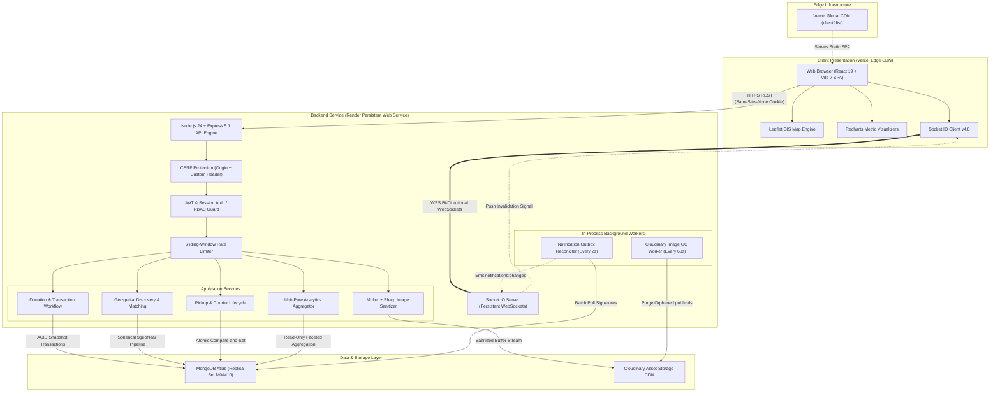
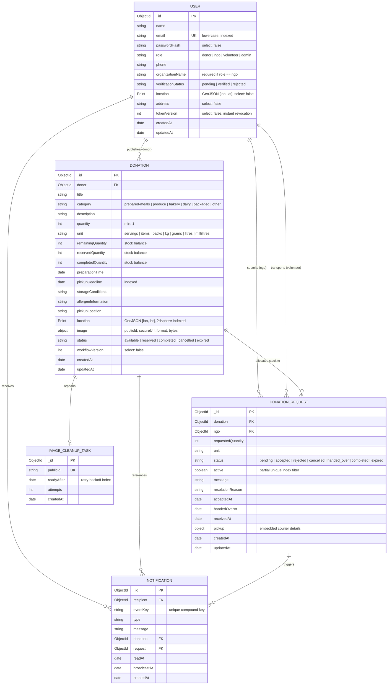
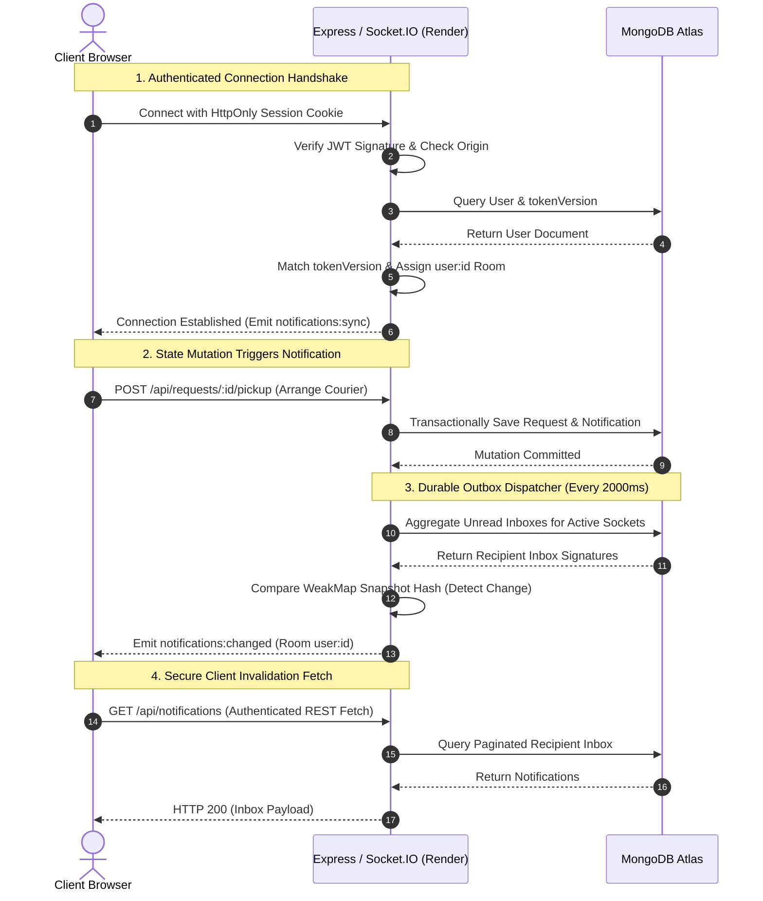

<div id="top"></div>

<div align="center">


# FoodBridge — Intelligent Surplus Food Redistribution

**Connecting surplus food with communities in need through secure, coordinated, real-time redistribution.**  
_An enterprise MERN-stack platform featuring ACID transactional reservations, explainable geospatial matching, and verified multi-leg logistics._

<br />

[](https://food-bridge-2jwl.vercel.app)
[](https://foodbridge-u7qa.onrender.com/api/health/ready)
[](https://nodejs.org/)
[](https://expressjs.com/)
[](https://react.dev/)
[](https://vitejs.dev/)
[](https://tailwindcss.com/)
[](https://www.mongodb.com/atlas)
[](https://socket.io/)
[](https://cloudinary.com/)
[](https://vitest.dev/)

<br />

> 🚀 **[Launch Live App](https://food-bridge-2jwl.vercel.app/)** · 📹 **[Watch Demo Video](https://drive.google.com/file/d/11nMJ3WroIEbdgF13avGs0MUHQdxiAmd5/view?usp=sharing)** · 💻 **[GitHub Repository](https://github.com/CodedStars-hub/FoodBridge)** · 🏗️ **[System Architecture](#e-system-architecture)** · ⚡ **[Quick Start](#n-quick-start)**  
> ⚡ **Verified Backend API Readiness**: **[`foodbridge-u7qa.onrender.com/api/health/ready`](https://foodbridge-u7qa.onrender.com/api/health/ready)**

<br />

[Problem & Vision](#a-problem--vision) · [The FoodBridge Solution](#b-the-foodbridge-solution) · [Why FoodBridge?](#c-why-foodbridge) · [Core Engineering Engine](#d-core-engineering-engine) · [System Architecture](#e-system-architecture) · [Interactive Modules](#f-interactive-modules) · [Donation Lifecycle Diagram](#g-donation-lifecycle-diagram) · [Database Architecture](#h-database-architecture) · [Authentication & Security](#i-authentication--security) · [Real-Time Communication](#j-real-time-communication) · [API Specification](#k-api-specification) · [Technology Stack](#l-technology-stack) · [Live Demo & Deployment](#m-live-demo--deployment) · [Quick Start](#n-quick-start) · [Project Structure](#o-project-structure) · [Testing & Reliability](#p-testing--reliability) · [Engineering Decisions & Tradeoffs](#q-engineering-decisions--tradeoffs) · [Roadmap](#r-roadmap) · [Contributing & License](#s-contributing--license)

</div>

---

## A. Problem & Vision

Institutional food waste occurs at an unprecedented scale across commercial kitchens, college cafeterias, banquet facilities, restaurants, and grocery retailers. While millions experience nutritional insecurity every day, tons of wholesome, edible prepared meals and fresh produce are discarded daily due to **severe structural inefficiencies in last-mile recovery and coordination**.

Simply posting an uncoordinated food listing on a message board or chat group fails to solve the crisis. Traditional surplus redistribution collapses under six operational failure modes:

### 1. The Perishability & Time-Window Trap

Prepared food is biologically time-critical. Meals are bound by strict preparation timestamps and rapid ambient temperature degradation. A delay of two to four hours between kitchen overproduction and intake can transform nutritious meals into biohazardous waste. Without immediate automated discovery, real-time dispatch, and hard expiration boundaries, food spoil occurs before prospective beneficiaries can respond.

### 2. Information Asymmetry & The "Cold Call" Dilemma

Kitchen staff and cafeteria managers lack the bandwidth to manually call dozens of local shelters when a 100-serving surplus arises late at night. Conversely, non-governmental organizations (NGOs) and community shelters operate with unpredictable beneficiary volumes, lacking visibility into where surplus food exists, whether transportation requirements (dry, cold-chain, hot-holding) match their capabilities, or how allergens are cataloged.

### 3. Inventory Over-Allocation & Race Conditions

Informal coordination channels (such as WhatsApp groups, SMS threads, or manual phone trees) lack transactional concurrency control. When a donor announces a surplus batch in a group, multiple charities often mobilize transport simultaneously. One charity arrives to find the batch already collected, squandering precious volunteer hours and fuel, while another charity remains empty-handed.

### 4. Last-Mile Logistics & The Transportation Barrier

Donors rarely have delivery vehicles or staff to transport food; grassroots shelters often lack dedicated drivers. Bridging this geographical divide requires **on-demand volunteer couriers**. However, routing volunteer drivers requires verified pickup coordinates, secure handoff protocols, real-time status transitions, and fallback contingency handling when a volunteer encounters delays or cancels.

### 5. Identity Verification & Liability Concerns

Institutional donors hesitate to distribute food anonymously due to safety, quality, and liability concerns. Sustainable food recovery demands authenticated organizational identities, verified 501(c)(3) or charitable registration, allergen and packaging disclosures, and digital signatures acknowledging custody transfer.

### 6. The FoodBridge Vision

**FoodBridge** replaces fragmented manual communication with a **deterministic, transactional redistribution engine**. Engineered as a high-integrity, full-stack MERN application, FoodBridge provides:

- **ACID Transactional Reservations**: MongoDB replica set snapshot transactions guaranteeing zero over-allocation, zero phantom claims, and automatic stock conservation.
- **Explainable Geospatial Matching**: Multi-criteria spherical `$geoNear` discovery ranking batches by distance, volume fulfillment ratio, and expiration urgency.
- **Multi-Leg Logistics State Machine**: A structured courier lifecycle with immutable audit events connecting donors, couriers, and NGO recipients.
- **Instant Invalidation & State Sync**: Socket.IO push notifications synchronized with durable database outboxes for real-time collaboration.
- **Unit-Pure Analytics**: A reporting engine that strictly prohibits mathematically invalid unit mixing (e.g., combining kilograms and servings), delivering defensible impact metrics.

---

## B. The FoodBridge Solution

FoodBridge creates an interconnected digital ecosystem connecting four distinct stakeholders: **Food Donors**, **Verified NGOs**, **Volunteer Couriers**, and **Platform Administrators**.

```
┌───────────────────────────────────────────────────────────────────────────────────────────────────┐
│                                   THE END-TO-END FOODBRIDGE WORKFLOW                              │
├─────────────────┬──────────────────┬─────────────────┬──────────────────┬─────────────────────────┤
│ 1. DONOR        │ 2. NGO           │ 3. DONOR        │ 4. VOLUNTEER     │ 5. RECIPIENT            │
│    PUBLISHES    │    DISCOVERS     │    RESERVES     │    TRANSPORTS    │    CONFIRMS             │
├─────────────────┼──────────────────┼─────────────────┼──────────────────┼─────────────────────────┤
│ Commercial      │ Verified NGOs    │ Donor reviews   │ Courier claims   │ NGO shelter             │
│ kitchen creates │ browse map with  │ request, locks  │ task, navigates  │ confirms delivery;      │
│ food listing    │ geospatial $geo- │ inventory in    │ to donor pickup, │ inventory balance       │
│ with deadline & │ Near & explain-  │ ACID snapshot   │ and initiates    │ resolves to completed;  │
│ allergens.      │ able match score.│ transaction.    │ verified handoff.│ audit log finalized.    │
└─────────────────┴──────────────────┴─────────────────┴──────────────────┴─────────────────────────┘
```

### The End-to-End Operational Lifecycle

1. **Donation Creation**: An authenticated donor specifies item details, category, quantity, unit, preparation time, strict pickup deadline, storage conditions, allergens, and collection coordinates. Photos are sanitized and uploaded to Cloudinary.
2. **Discovery & Matching**: Verified NGOs search active listings via interactive Leaflet maps. The system evaluates distance, batch quantity, and time remaining, generating an explainable recommendation score.
3. **Transactional Request & Reservation**: An NGO submits an allocation request. The donor reviews incoming requests and accepts. A MongoDB snapshot transaction atomically decrements the available quantity, increments reserved inventory, and generates an accepted reservation.
4. **Logistics & Volunteer Dispatch**: The NGO arranges transportation, creating a courier pickup task. Verified volunteers discover open delivery runs, claim tasks via atomic compare-and-set operations, and transition through transit states (`assigned` $\rightarrow$ `en_route_to_pickup` $\rightarrow$ `picked_up` $\rightarrow$ `delivered`).
5. **Two-Party Verification & Receipt**: The donor confirms physical handover to the volunteer. Upon arrival at the shelter, the NGO inspects the delivery and confirms receipt, transitioning the request to `completed` and locking the inventory record.
6. **Automated Expiry Sweeps**: If a pickup deadline passes with uncollected or unreserved inventory, background workers transactionally expire the listing, release pending requests, and cancel uncollected transport tasks.

---

## C. Why FoodBridge?

FoodBridge replaces the chaotic vulnerability of manual communication with deterministic engineering:

| Dimension                   | Informal Coordination (WhatsApp / Calls)                   | Manual Tracking (Google Sheets / Excel)                       | FoodBridge Platform Engine                                                             |
| :-------------------------- | :--------------------------------------------------------- | :------------------------------------------------------------ | :------------------------------------------------------------------------------------- |
| **Donation Visibility**     | ❌ Ephemeral; buried in unstructured chat streams          | ⚠️ Static rows; zero real-time visibility for field workers   | ✅ **Live searchable catalog with interactive Leaflet map integration**                |
| **Verified Participation**  | ❌ Unverified phone numbers; zero role boundaries          | ❌ Flat document access; no identity or credential validation | ✅ **Strict Role-Based Access Control (RBAC) with verified organization statuses**     |
| **Food Expiry Awareness**   | ❌ Manual memory; expired food discovered upon arrival     | ⚠️ Passive dates; requires manual sheet auditing              | ✅ **Automated deadline enforcement with transactional cascade cancellation**          |
| **Reservation Integrity**   | ❌ Race conditions; double-booking and wasted transport    | ⚠️ High human error; concurrent edits overwrite cells         | ✅ **ACID MongoDB snapshot transactions with atomic inventory decrements**             |
| **Location-Aware Matching** | ❌ None; plain-text addresses without distance calculation | ❌ Tabular data; no spatial proximity ranking                 | ✅ **Spherical `$geoNear` 2dsphere indexing with explainable multi-factor scoring**    |
| **Pickup Coordination**     | ❌ Uncoordinated; drivers dispatched without tracking      | ❌ Disconnected from real-time vehicle or courier status      | ✅ **Structured courier lifecycle with route addresses and immutable audit logs**      |
| **Real-Time Notifications** | ❌ Noisy group pings; critical alerts missed               | ❌ Zero push mechanism; users must manually poll              | ✅ **Socket.IO push-invalidation hints synchronized with durable DB inboxes**          |
| **Donation History**        | ❌ Fragmented message logs; no central audit trail         | ⚠️ Inconsistent manual data entry; easily altered or lost     | ✅ **Permanent, immutable audit event streams for every handoff and state transition** |
| **Data Integrity**          | ❌ Zero reporting capabilities                             | ⚠️ Incongruent sum formulas (adding kg and meals together)    | ✅ **Unit-pure aggregation; food counted strictly upon verified recipient receipt**    |

---

## D. Core Engineering Engine

FoodBridge’s core is built around mathematical determinism, transactional consistency, and strict operational invariants.

```
                                  INCOMING INVENTORY MUTATION
                                [Donor Listing / NGO Request / Expiry]
                                                 │
                                                 ▼
┌─────────────────────────────────────────────────────────────────────────────────────────────────┐
│                                   TRANSACTIONAL WORKFLOW ENGINE                                 │
│                                                                                                 │
│   1. ACID SNAPSHOT ISOLATION:   mongoose.connection.transaction({                               │
│                                   readConcern: { level: 'snapshot' },                           │
│                                   writeConcern: { w: 'majority' }                               │
│                                 })                                                              │
│                                                                                                 │
│   2. INVENTORY BALANCE CHECK:   quantity === remainingQuantity + reservedQuantity + completed   │
│                                                                                                 │
│   3. CONCURRENCY & LOCKING:     Atomic findOneAndUpdate with remainingQuantity >= requested     │
│                                 Partial Unique Index: { donation: 1, ngo: 1, active: true }     │
│                                                                                                 │
│   4. DETERMINISTIC EXPOSURE:    displayStatus() = expired | cancelled | reserved | available    │
└────────────────────────────────────────────────┬────────────────────────────────────────────────┘
                                                 │
                                                 ▼
┌─────────────────────────────────────────────────────────────────────────────────────────────────┐
│                                 EXPLAINABLE GEOSPATIAL MATCHING                                 │
│                                                                                                 │
│   • Distance Score:             C_dist = 100 × max(0, 1 - distanceKm / radiusKm)                │
│   • Quantity Score:             C_qty  = 100 × min(1, requestedQty / availableQty)              │
│   • Expiry Window Score:        C_time = 100 × max(0, min(1, minutesRemaining / windowMinutes)) │
│   • Composite Recommendation:   Score  = (w_dist × C_dist) + (w_qty × C_qty) + (w_time × C_time)│
│                                 Weights: Distance 40%, Quantity 35%, Pickup Window 25%          │
└────────────────────────────────────────────────┬────────────────────────────────────────────────┘
                                                 │
                                                 ▼
┌─────────────────────────────────────────────────────────────────────────────────────────────────┐
│                                  VOLUNTEER COURIER STATE MACHINE                                │
│                                                                                                 │
│   awaiting_volunteer ──► assigned ──► en_route_to_pickup ──► picked_up ──► delivered            │
│   [Audit Events Logged]: action, status, actor, at, reason                                      │
└─────────────────────────────────────────────────────────────────────────────────────────────────┘
```

### 1. Transactional Donation Reservations

FoodBridge prevents double-booking and phantom claims through **MongoDB multi-document snapshot transactions** (`donationWorkflow.js`).

- **Snapshot Isolation**: All reads and writes within a reservation workflow execute with `readConcern: 'snapshot'` and `writeConcern: 'majority'`, guaranteeing that intermediate states remain invisible to other concurrent operations.
- **Atomic Inventory Allocation**: When a donor accepts a request, the server executes an atomic `findOneAndUpdate` that validates conditions before mutating balances:
  ```javascript
  const updated = await Donation.findOneAndUpdate(
    {
      _id: donation._id,
      remainingQuantity: { $gte: request.requestedQuantity },
      pickupDeadline: { $gt: new Date() },
      status: 'available',
    },
    {
      $inc: {
        remainingQuantity: -request.requestedQuantity,
        reservedQuantity: request.requestedQuantity,
        workflowVersion: 1,
      },
      $set: {
        status:
          donation.remainingQuantity === request.requestedQuantity
            ? 'reserved'
            : 'available',
      },
    },
    { session, new: true },
  );
  ```
- **Conflict Detection**: If two donors or NGOs act on the same listing simultaneously, the losing operation detects the version mismatch or inventory exhaustion and fails gracefully with `HTTP 409 Conflict`.
- **Duplicate Request Neutralization**: The database enforces a partial unique compound index on `DonationRequest`:
  ```javascript
  schema.index(
    { donation: 1, ngo: 1 },
    { unique: true, partialFilterExpression: { active: true } },
  );
  ```
  This guarantees at the database level that an NGO cannot submit duplicate concurrent active claims for the same donation batch.

### 2. Donation Lifecycle & Invariant Validation

The donation lifecycle adheres to strict mathematical invariants. Every document enforces pre-validation checks:
$$\text{quantity} \equiv \text{remainingQuantity} + \text{reservedQuantity} + \text{completedQuantity}$$

- **Temporal Rules**: `pickupDeadline` must strictly succeed `preparationTime` (`pickupDeadline > preparationTime`), and `pickupDeadline` must be in the future.
- **Immutability Under Reservation**: A donor cannot edit or reduce the quantity of a listing once active reservation requests exist. Edits require all active requests to be resolved first.

### 3. Explainable Geospatial Matching

Rather than relying on opaque heuristics or artificial scoring, FoodBridge evaluates location and viability using MongoDB’s spherical `$geoNear` aggregation pipeline over a `2dsphere` spatial index:

- **Distance Calculation**: Computes geodesic haversine distance between the listing collection coordinates and the NGO shelter coordinates.
- **Multi-Factor Explainable Scoring Formula**:
  $$\text{Score} = w_{\text{dist}} \cdot C_{\text{dist}} + w_{\text{qty}} \cdot C_{\text{qty}} + w_{\text{time}} \cdot C_{\text{time}}$$
  - **Distance Component ($C\_{\text{dist}}$)**: Measures geographical proximity relative to maximum search radius:
    $$C_{\text{dist}} = 100 \times \max\left(0, 1 - \frac{\text{distanceKm}}{\text{radiusKm}}\right)$$
  - **Quantity Component ($C\_{\text{qty}}$)**: Evaluates volume fulfillment capability:
    $$C_{\text{qty}} = 100 \times \min\left(1.0, \frac{\text{requestedQuantity}}{\text{availableQuantity}}\right)$$
  - **Pickup Urgency Component ($C\_{\text{time}}$)**: Balances remaining window against baseline operational duration:
    $$C_{\text{time}} = 100 \times \max\left(0, \min\left(1.0, \frac{\text{minutesRemaining}}{\text{windowMinutes}}\right)\right)$$
- **Configurable Weights**: Defaults to 40% distance (`MATCH_DISTANCE_WEIGHT`), 35% quantity (`MATCH_QUANTITY_WEIGHT`), and 25% urgency (`MATCH_TIME_WEIGHT`). The API returns the composite score along with the exact constituent components for complete transparency.

### 4. Volunteer Pickup Logistics State Machine

Logistics coordination is modeled as an embedded state machine inside `DonationRequest` (`pickup.js`, `pickupWorkflow.js`):

- **Arranging Transportation**: Verified NGOs configure transport requirements, converting the request's embedded pickup state to `awaiting_volunteer`.
- **Atomic Claiming**: Unassigned pickups can only be claimed by verified volunteers via atomic match-and-set queries (`pickup.status: 'awaiting_volunteer'`, `pickup.volunteer: null`).
- **Courier Lifecycle**: State progresses strictly:
  $$\text{awaiting\_volunteer} \longrightarrow \text{assigned} \longrightarrow \text{en\_route\_to\_pickup} \longrightarrow \text{picked\_up} \longrightarrow \text{delivered}$$
- **Immutable Audit Trail**: Every change appends an immutable entry to `pickup.events`:
  ```javascript
  { action: 'claim', status: 'assigned', actor: volunteerId, at: new Date(), reason: '' }
  ```
- **Cancellation Fallbacks**: If a volunteer releases a pickup or transportation is cancelled prior to physical handover, the underlying food reservation remains intact, reverting the pickup to direct NGO-donor collection.

### 5. Automated Expiry Management

Perishability is governed through active evaluation and scheduled sweep logic (`donationWorkflow.js`, `scripts/expireDonations.js`):

- **Active Status Masking**: Even before background sweeps execute, any query or detail view passes through `displayStatus()`; if `pickupDeadline <= now`, the listing is masked as `expired`.
- **Transactional Cascading Expiration**: The expiration engine scans overdue listings inside a database transaction:
  1. Identifies all uncollected reservations (`accepted` requests).
  2. Releases reserved quantities back to the listing balance.
  3. Sets listing status to `expired`.
  4. Cancels associated uncompleted volunteer courier tasks with audit reason `"Pickup deadline passed"`.
  5. Updates all pending and accepted requests to `expired` (`active: false`).
  6. Emits notifications to affected participants.

### 6. Role-Based Security: Authentication vs. Authorization vs. Verification

FoodBridge strictly delineates three security dimensions:

- **Authentication**: Verifies user identity via cryptographically signed JWT cookies (`HS256`, 24h validity).
- **Authorization**: Gated by role middleware (`authorizeRoles('donor', 'ngo', 'volunteer', 'admin')`), preventing cross-role horizontal privilege escalation.
- **Verification**: Account registration defaults to `verificationStatus: 'pending'`. While users can explore public views, critical operational actions (NGO food requests, volunteer delivery claims) require administrative credential review (`verificationStatus: 'verified'`).

---

## E. System Architecture

FoodBridge separates static edge delivery from persistent, transactional API and WebSocket execution:



### Why Frontend and Backend Are Deployed Separately

- **Frontend on Vercel**: Delivers pre-compiled static assets (`client/dist`) from globally distributed edge locations with sub-50ms TTFB, automated Brotli compression, and immutable cache headers.
- **Backend on Render**: Hosted as a **long-lived persistent Node.js Web Service process** rather than ephemeral serverless functions. This persistent runtime is mandatory for:
  1. **Persistent Bi-Directional WebSockets**: Socket.IO requires stateful TCP connections and in-memory room associations that cannot survive serverless container teardowns.
  2. **Connection Pool Warmth**: MongoDB replica set transactions require sustained connection pools to avoid expensive TLS re-handshakes and connection exhaustion.
  3. **Continuous Background Schedulers**: Powers the 2,000ms real-time notification reconciler and 60-second image cleanup tasks without external cron dependencies.

---

## F. Interactive Modules

FoodBridge organizes features into specialized, role-tailored workspaces:

```
┌─────────────────────────────────────────────────────────────────────────────────────────────────┐
│                                   ROLE WORKSPACE ARCHITECTURE                                   │
├──────────────────────────┬──────────────────────────┬──────────────────────────┬────────────────┤
│ 1. DONOR DASHBOARD       │ 2. NGO DASHBOARD         │ 3. VOLUNTEER DASHBOARD   │ 4. ADMIN PANEL │
│ • Listing publishing     │ • Proximity map explorer │ • Available courier runs │ • Verification │
│ • Reservation decisions  │ • Multi-factor matching  │ • Active transit routing │ • Moderation   │
│ • Inventory management   │ • Request allocations    │ • Arrival reporting      │ • Audit logs   │
│ • Handover confirmation  │ • Transport setup        │ • Issue resolution       │ • Platform KPI │
└──────────────────────────┴──────────────────────────┴──────────────────────────┴────────────────┘
```

### 1. Donor Workspace (`/dashboard/donor`)

- **User Purpose**: Allows catering directors, restaurant managers, and cafeteria supervisors to publish, monitor, and manage surplus inventory.
- **Key Operations**: Create listings, edit active batches, upload food photographs, accept/reject incoming allocation requests, confirm handovers, and review distribution history.
- **Backend Behavior**: Handled by `donationController.js` and `donationWorkflow.js`. Listings enforce inventory balance constraints. Updating or cancelling an active listing triggers notification dispatches to affected NGOs.
- **Important Constraints**: Edits are locked when active reservation requests exist. Quantities must be positive integers. Pickups require a verified recipient.

### 2. NGO Workspace (`/dashboard/ngo`)

- **User Purpose**: Enables charities, shelters, and food pantries to discover available surplus, request portions, organize volunteer couriers, and confirm delivery.
- **Key Operations**: Browse nearby listings via Leaflet map (`/dashboard/ngo/nearby`), inspect explainable matches (`/dashboard/ngo/recommended`), request allocations (`/dashboard/ngo/requests`), configure volunteer transport, and acknowledge delivery receipts.
- **Backend Behavior**: Queries `discoveryService.js` using spherical `$geoNear` aggregation pipelines. Submitting a request creates an entry in `DonationRequest` with partial unique index verification.
- **Important Constraints**: Requesting allocations requires account verification (`verificationStatus: 'verified'`). Requests cannot exceed remaining inventory.

### 3. Volunteer Courier Workspace (`/dashboard/volunteer`)

- **User Purpose**: Empowers community volunteers to support last-mile food recovery by claiming deliveries and transporting food between donors and shelters.
- **Key Operations**: Browse open tasks (`/dashboard/volunteer/pickups/available`), claim delivery assignments, update transit milestones (`en_route_to_pickup`, `arrive`), and log transport issues.
- **Backend Behavior**: Handled by `pickupController.js` and `pickupWorkflow.js`. Claims execute through atomic compare-and-set updates preventing dual-driver assignment.
- **Important Constraints**: Volunteers must be verified. Deliveries cannot be cancelled after physical donor handover without administrative or donor resolution.

### 4. Admin Management Workspace (`/dashboard/admin`)

- **User Purpose**: Provides platform administrators with moderation tools to review registered organizations and oversee platform health.
- **Key Operations**: Inspect pending donor, NGO, and volunteer registrations, review verification credentials, evaluate system throughput, and inspect unread notification queues.
- **Backend Behavior**: Handled by `userController.js` and `analyticsService.js`. Reads system aggregation pipelines across users, listings, and delivery statuses.
- **Important Constraints**: Admin accounts cannot be created through public registration; they must be seeded via the local `bootstrapAdmin.js` CLI tool.

---

## G. Donation Lifecycle Diagram

The following state machine details all possible transitions and role authorization boundaries across listings and requests:

```mermaid
flowchart TD
    subgraph DonationListing ["Donation Listing States"]
        D_Init([Draft / Creation]) -->|Donor: POST /api/donations| D_Avail[Status: available]
        D_Avail -->|Donor: Accepts Requests to Full Capacity| D_Res[Status: reserved]
        D_Avail -->|Donor: POST /api/donations/:id/cancel| D_Canc[Status: cancelled]
        D_Avail -->|System: Deadline Passed| D_Exp[Status: expired]
        D_Res -->|NGO: Cancels Active Reservation| D_Avail
        D_Res -->|System: Deadline Passed| D_Exp
        D_Res -->|NGO: Confirms Full Delivery Receipt| D_Comp[Status: completed]
    end

    subgraph RequestWorkflow ["Allocation Request States"]
        R_Init([NGO Request]) -->|Verified NGO: POST /api/donations/:id/requests| R_Pend[Status: pending]
        R_Pend -->|Donor: PATCH accept| R_Acc[Status: accepted]
        R_Pend -->|Donor: PATCH reject| R_Rej[Status: rejected]
        R_Pend -->|NGO: PATCH cancel| R_Canc[Status: cancelled]
        R_Pend -->|System: Donation Cancelled or Expired| R_Exp[Status: expired / cancelled]

        R_Acc -->|NGO: POST /pickup| P_Awaiting[Pickup: awaiting_volunteer]
        R_Acc -->|Donor: PATCH handover (Direct)| R_Hand[Status: handed_over]
        R_Acc -->|NGO: PATCH cancel (Returns Inventory)| R_Canc

        P_Awaiting -->|Volunteer: POST /claim| P_Assigned[Pickup: assigned]
        P_Assigned -->|Volunteer: PATCH start| P_EnRoute[Pickup: en_route_to_pickup]
        P_EnRoute -->|Donor: PATCH handover| R_Hand

        R_Hand -->|Volunteer: PATCH arrive| P_Delivered[Pickup: delivered]
        R_Hand -->|NGO: PATCH receive| R_Comp[Status: completed]
    end

    D_Avail -.->|Enables| R_Init
    R_Comp -.->|Fulfills| D_Comp
```

---

## H. Database Architecture

FoodBridge’s data layer is modeled using Mongoose 8 over MongoDB Atlas:



### Critical Indexes & Data Integrity Constraints

1. **Compound Partial Unique Index for Request Concurrency**:
   - `{ donation: 1, ngo: 1 }` with `{ unique: true, partialFilterExpression: { active: true } }` prevents duplicate active requests by the same NGO.
2. **2dsphere Spatial Index**:
   - `{ location: '2dsphere' }` on `Donation` and `User` enables spherical distance calculation and `$geoNear` proximity matching.
3. **Compound Expiry Index**:
   - `{ status: 1, pickupDeadline: 1, createdAt: -1 }` on `Donation` powers fast discovery queries and deadline cleanup cursors.
4. **Idempotent Notification Index**:
   - `{ recipient: 1, eventKey: 1 }` with `{ unique: true }` guarantees that no event generates duplicate notification records.

---

## I. Authentication & Security

FoodBridge implements defense-in-depth security principles across authentication, authorization, and network ingress:

### 1. Cryptographic Password Hashing

- **Bcrypt Work Factor 12**: Passwords are hashed using `bcryptjs` with salt rounds set to 12.
- **Length Constraints & Truncation Defense**: Signup enforces a minimum password length of 12 characters and a maximum of 72 UTF-8 bytes, neutralizing bcrypt's null-byte truncation vulnerability.
- **Timing-Attack Mitigation**: Login comparisons execute against uniform mock hashes when non-existent email addresses are queried, preventing timing enumeration attacks.

### 2. Cookie-Based Session Management & Instant Revocation

- **HttpOnly, Host-Prefixed Cookies**: Sessions utilize `__Host-foodbridge_session` cookies in production with `HttpOnly`, `Secure`, and `Path=/`. Tokens cannot be read by browser JavaScript, blocking XSS token harvesting.
- **Cryptographic Token Structure**: Signed with `HS256`, containing subject user ID (`sub`) and session version (`version`).
- **Atomic Session Invalidation**: The database stores a `tokenVersion` integer for each user. Logging out atomically increments this version in MongoDB and clears the client cookie, instantly invalidating copied JWT tokens.

### 3. Custom-Header CSRF Protection

All state-mutating API routes (`POST`, `PATCH`, `DELETE`) enforce three simultaneous checks:

1. Validated allowlisted `Origin` header matching `CLIENT_ORIGINS`.
2. Content-Type set to `application/json` (or `multipart/form-data` for image uploads).
3. The custom request header **`X-CSRF-Protection: foodbridge`**.  
   Standard HTML forms and cross-origin scripts cannot forge custom HTTP headers without passing preflight CORS verification, securing cross-domain communication between Vercel and Render.

### 4. Adaptive Rate Limiting

- `/api/auth/login`: 20 attempts per 15 minutes.
- `/api/auth/register`: 10 attempts per 15 minutes.
- `/api/donations/:id/image`: 30 uploads per 15 minutes.
- Supports in-memory sliding windows for single-process demo deployments and Upstash Redis HTTPS counters for multi-instance production scaling.

---

## J. Real-Time Communication

FoodBridge integrates Socket.IO 4.8 over persistent WebSockets, utilizing an event-driven push-invalidation architecture:



### Real-Time Invariants

- **Zero Client-Controlled Messaging**: Clients cannot broadcast arbitrary payloads, join arbitrary rooms, or trigger socket events. Sockets are **strictly server-to-client notification channels**.
- **Push-Invalidation Pattern**: To maintain centralized access control, the server emits empty `notifications:changed` invalidation hints. The client responds by querying its authenticated REST endpoint, ensuring pagination, projections, and authorization rules are never bypassed.

---

## K. API Specification

All protected endpoints require session authentication. Mutation routes require the `X-CSRF-Protection: foodbridge` header.

### 1. Authentication & Identity (`/api/auth`, `/api/users`)

| Method  | Route                | Description                       | Auth / Role   | Key Request Fields                                           | Key Response Fields                                                     |
| :------ | :------------------- | :-------------------------------- | :------------ | :----------------------------------------------------------- | :---------------------------------------------------------------------- |
| `POST`  | `/api/auth/register` | Register new user account         | Public        | `{ name, email, password, role, organizationName?, phone? }` | `{ user: { id, name, email, role, verificationStatus } }`               |
| `POST`  | `/api/auth/login`    | Authenticate & set session cookie | Public        | `{ email, password }`                                        | `{ user: { id, name, email, role, verificationStatus } }`               |
| `GET`   | `/api/auth/me`       | Restore authenticated identity    | Authenticated | None                                                         | `{ user: { id, name, email, role, verificationStatus } }`               |
| `POST`  | `/api/auth/logout`   | Revoke sessions & clear cookie    | Authenticated | `{}`                                                         | `{ success: true }`                                                     |
| `GET`   | `/api/users/me`      | Fetch full user profile           | Authenticated | None                                                         | `{ user: { id, name, email, role, phone, organizationName, address } }` |
| `PATCH` | `/api/users/me`      | Update safe profile attributes    | Authenticated | `{ name?, phone?, organizationName?, address?, location? }`  | `{ user: { ...updatedProfile } }`                                       |

### 2. Surplus Donations (`/api/donations`)

| Method   | Route                            | Description                           | Auth / Role   | Key Request Fields                                                                                                                                     | Key Response Fields                                                                   |
| :------- | :------------------------------- | :------------------------------------ | :------------ | :----------------------------------------------------------------------------------------------------------------------------------------------------- | :------------------------------------------------------------------------------------ |
| `GET`    | `/api/donations`                 | Browse public listings                | Authenticated | Query: `category`, `unit`, `search`, `page`, `limit`                                                                                                   | `{ items: [...], pagination: { page, total, pages } }`                                |
| `GET`    | `/api/donations/mine`            | List donor's own listings             | Donor         | Query: `status`, `page`, `limit`                                                                                                                       | `{ items: [...], pagination: { page, total, pages } }`                                |
| `GET`    | `/api/donations/nearby`          | Geospatial spherical radius search    | NGO           | Query: `latitude`, `longitude`, `radiusKm`, `category`                                                                                                 | `{ items: [{ ...donation, distanceKm }] }`                                            |
| `GET`    | `/api/donations/recommendations` | Multi-factor explainable matches      | NGO           | Query: `latitude`, `longitude`, `quantity`, `unit`, `radiusKm`                                                                                         | `{ items: [{ ...donation, score, components: { distance, quantity, pickupTime } }] }` |
| `POST`   | `/api/donations`                 | Create surplus food listing           | Donor         | `{ title, category, description, quantity, unit, preparationTime, pickupDeadline, storageConditions, allergenInformation, pickupLocation, location? }` | `{ donation: { id, title, status: "available", quantity, remainingQuantity } }`       |
| `GET`    | `/api/donations/:id`             | Detailed listing information          | Authenticated | None                                                                                                                                                   | `{ donation: { ...detail, requestsCount, activeRequests } }`                          |
| `PATCH`  | `/api/donations/:id`             | Edit open listing (locked if claimed) | Donor (Owner) | `{ title?, description?, storageConditions?, ... }`                                                                                                    | `{ donation: { ...updatedDonation } }`                                                |
| `POST`   | `/api/donations/:id/cancel`      | Cancel listing & notify NGOs          | Donor (Owner) | `{}`                                                                                                                                                   | `{ donation: { id, status: "cancelled" } }`                                           |
| `POST`   | `/api/donations/:id/image`       | Upload listing photo via Sharp        | Donor (Owner) | `multipart/form-data` with `file` buffer (Max 5MB)                                                                                                     | `{ image: { publicId, secureUrl, width, height } }`                                   |
| `DELETE` | `/api/donations/:id/image`       | Remove listing photo & schedule GC    | Donor (Owner) | `{}`                                                                                                                                                   | `{ success: true }`                                                                   |

### 3. Allocation Requests & Logistics (`/api/requests`, `/api/pickups`)

| Method  | Route                         | Description                    | Auth / Role   | Key Request Fields                                                                      | Key Response Fields                                                                  |
| :------ | :---------------------------- | :----------------------------- | :------------ | :-------------------------------------------------------------------------------------- | :----------------------------------------------------------------------------------- |
| `POST`  | `/api/donations/:id/requests` | Request food allocation        | Verified NGO  | `{ requestedQuantity, message? }`                                                       | `{ request: { id, donation, requestedQuantity, status: "pending" } }`                |
| `GET`   | `/api/requests`               | List active user requests      | Donor / NGO   | Query: `status`, `page`, `limit`                                                        | `{ items: [...], pagination: { ... } }`                                              |
| `GET`   | `/api/requests/history`       | List historical requests       | Donor / NGO   | Query: `page`, `limit`                                                                  | `{ items: [...], pagination: { ... } }`                                              |
| `PATCH` | `/api/requests/:id`           | Transition request lifecycle   | Donor / NGO   | `{ action: "accept" \| "reject" \| "handover" \| "receive" \| "cancel" }`               | `{ request: { id, status, acceptedAt?, handedOverAt?, receivedAt? } }`               |
| `POST`  | `/api/requests/:id/pickup`    | Arrange volunteer transport    | NGO           | `{}`                                                                                    | `{ request: { id, pickup: { status: "awaiting_volunteer", origin, destination } } }` |
| `GET`   | `/api/pickups/available`      | Browse unassigned deliveries   | Verified Vol  | Query: `page`, `limit`                                                                  | `{ items: [...], pagination: { ... } }`                                              |
| `GET`   | `/api/pickups/mine`           | List volunteer's assignments   | Volunteer     | Query: `status`, `page`, `limit`                                                        | `{ items: [...] }`                                                                   |
| `GET`   | `/api/pickups/:id`            | View route details & audit log | Donor/NGO/Vol | None                                                                                    | `{ pickup: { status, origin, destination, events: [...] } }`                         |
| `POST`  | `/api/pickups/:id/claim`      | Claim courier delivery run     | Verified Vol  | `{}`                                                                                    | `{ pickup: { id, status: "assigned", volunteer: userId } }`                          |
| `PATCH` | `/api/pickups/:id`            | Update delivery milestone      | Donor/NGO/Vol | `{ action: "start" \| "arrive" \| "release" \| "report_failure" \| "cancel", reason? }` | `{ pickup: { id, status, arrivalReportedAt?, issue? } }`                             |

### 4. Notifications, Analytics & Health (`/api/notifications`, `/api/analytics`, `/api/health`)

| Method  | Route                         | Description                   | Auth / Role   | Key Request Fields                    | Key Response Fields                                                   |
| :------ | :---------------------------- | :---------------------------- | :------------ | :------------------------------------ | :-------------------------------------------------------------------- |
| `GET`   | `/api/notifications`          | Paginated notification inbox  | Authenticated | Query: `unread=true`, `page`, `limit` | `{ items: [...], unreadCount, pagination: { ... } }`                  |
| `PATCH` | `/api/notifications/read-all` | Mark all notifications read   | Authenticated | `{}`                                  | `{ unreadCount: 0 }`                                                  |
| `PATCH` | `/api/notifications/:id/read` | Mark single notification read | Authenticated | `{}`                                  | `{ notification: { id, readAt } }`                                    |
| `GET`   | `/api/analytics/:role`        | Role-scoped impact analytics  | Role Match    | Query: `from`, `to`, `range`          | `{ role, summary: { ... }, quantitiesByUnit: [...], monthly: [...] }` |
| `GET`   | `/api/health`                 | Fast process liveness check   | Public        | None                                  | `{ status: "ok" }`                                                    |
| `GET`   | `/api/health/ready`           | Deep database readiness check | Public        | None                                  | `{ status: "ready", timestamp, uptime }`                              |

---

## L. Technology Stack

| Technology                | Layer       | Version     | Architectural Responsibility                                                               |
| :------------------------ | :---------- | :---------- | :----------------------------------------------------------------------------------------- |
| **React**                 | Client      | `19.2.0`    | Declarative UI components, state management, concurrent rendering, and role layouts.       |
| **Vite**                  | Tooling     | `7.1.12`    | High-speed frontend dev server and optimized Rollup production asset compilation.          |
| **Tailwind CSS**          | Styling     | `4.1.16`    | Modern CSS styling using the `@tailwindcss/vite` engine with strict design tokens.         |
| **React Router DOM**      | Client      | `7.9.4`     | Declarative SPA routing, nested role workspaces, and protected route redirection.          |
| **Leaflet**               | Client GIS  | `1.9.4`     | Open-source mobile-friendly interactive maps for pickup and shelter visualization.         |
| **Recharts**              | Client      | `3.3.0`     | Composable SVG charts for monthly redistribution trends and unit volume breakdowns.        |
| **Node.js**               | Server      | `24 LTS`    | Modern asynchronous JavaScript runtime executing backend server processes.                 |
| **Express**               | Server      | `5.1.0`     | Core HTTP framework structuring middleware chains, REST routing, and error handlers.       |
| **Mongoose**              | Database    | `8.19.2`    | MongoDB ODM providing schema validation, pre-hooks, and ACID snapshot transactions.        |
| **Socket.IO**             | Real-Time   | `4.8.1`     | Stateful bi-directional WebSocket engine powering real-time notification sync.             |
| **Sharp**                 | Media       | `0.35.5`    | High-performance image processing engine for EXIF sanitization and WebP conversion.        |
| **Cloudinary**            | Media Cloud | `2.7.0`     | Cloud media storage with automatic CDN distribution and format transcoding.                |
| **Zod**                   | Validation  | `4.1.12`    | TypeScript-first runtime schema validation for environments, bodies, and query parameters. |
| **Bcryptjs & JWT**        | Security    | `3.0 / 9.0` | Adaptive password hashing (cost factor 12) and stateless signed session tokens (HS256).    |
| **Helmet & CORS**         | Security    | `8.1 / 2.8` | Automated HTTP response security headers and strict credentialed origin allowlists.        |
| **Vitest**                | Testing     | `5.0.5`     | High-speed native ES module test runner driving server and client test suites.             |
| **MongoDB Memory Server** | Testing     | `10.2.1`    | Ephemeral local MongoDB replica sets executing snapshot transaction tests in CI.           |

---

## M. Live Demo & Deployment

FoodBridge is deployed across production cloud infrastructure engineered for high reliability, persistent WebSocket streaming, and secure cross-origin isolation:

<br />

<div align="center">

### 🌐 Live Production Deployments

**[Launch Live Application (Vercel)](https://food-bridge-2jwl.vercel.app/)**  
_The complete responsive single-page web application._

**[Watch Production Demonstration Video (Google Drive)](https://drive.google.com/file/d/11nMJ3WroIEbdgF13avGs0MUHQdxiAmd5/view?usp=sharing)**  
_Full video walk-through demonstrating the live application, user roles, and surplus food redistribution workflow._

**[Backend API Service (Render)](https://foodbridge-u7qa.onrender.com/)**  
_Persistent Node.js + Express + Socket.IO API server._

**[Inspect API Health & Readiness](https://foodbridge-u7qa.onrender.com/api/health/ready)**  
_Live production endpoint verifying database connectivity and operational uptime._

</div>

<br />

### Deployed Architecture

- **Frontend: Vercel Edge Network**: Deploys `client/dist` across Vercel’s global CDN. `vercel.json` provides strict security directives (`X-Content-Type-Options: nosniff`, `X-Frame-Options: DENY`, `Strict-Transport-Security: max-age=31536000`) and deterministic SPA fallback rewrites to `/index.html`.
- **Backend: Render Web Service**: Deploys a persistent Node 24 web service from the repository root. Configured with a dedicated port listener, zero cold-start WebSocket channels, and graceful `SIGTERM`/`SIGINT` teardown hooks.
- **Database: MongoDB Atlas Replica Set**: Multi-node replica set cluster providing high-availability storage, primary-secondary replication, and snapshot isolation transactions.
- **Media Cloud: Cloudinary**: Managed cloud object storage for donor food listings with automated delivery optimization.

### Verified Production Environment Configuration

The frontend and backend coordinate through explicit environment variables:

- **Frontend (`Vercel`)**:
  - `VITE_API_URL=https://foodbridge-u7qa.onrender.com/api` (Routes browser API calls to Render).
- **Backend (`Render`)**:
  - `NODE_ENV=production` & `NODE_VERSION=24`
  - `CLIENT_ORIGIN=https://food-bridge-2jwl.vercel.app` (Strictly allowlisted CORS origin).
  - `COOKIE_SAME_SITE=none` (Enables secure cross-site credentialed cookies over HTTPS).
  - `CLIENT_IP_SOURCE=socket` & `RATE_LIMIT_STORE=process-demo` & `DEMO_SINGLE_PROCESS=true` (Conservative demo rate limiting).
  - `MONGODB_URI=<Atlas_Replica_Set_URI>`
  - `JWT_SECRET=<32_Character_Hex_Secret>`
  - `CLOUDINARY_CLOUD_NAME`, `CLOUDINARY_API_KEY`, `CLOUDINARY_API_SECRET`

---

## N. Quick Start

Follow these copy-paste instructions to run FoodBridge locally:

### Prerequisites

- **Node.js**: `v24 LTS` recommended (also supports `v22.12.0+` or `v26+`).
- **npm**: `v10+`.
- **MongoDB**: A running **MongoDB Atlas** cluster or a local replica set (e.g., `rs0`).  
  _Note: MongoDB snapshot transactions for donation reservations require a replica set._

### 1. Clone & Install Dependencies

```bash
git clone https://github.com/CodedStars-hub/FoodBridge.git
cd FoodBridge
npm install
```

### 2. Configure Local Environments

Copy the environment examples for both client and server:

```bash
cp client/.env.example client/.env
cp server/.env.example server/.env
```

Generate a secure random string for JWT signing:

```bash
openssl rand -hex 32
```

Edit `server/.env`:

```dotenv
NODE_ENV=development
PORT=5001
CLIENT_ORIGIN=http://localhost:5173
MONGODB_URI=mongodb://127.0.0.1:27017/foodbridge?replicaSet=rs0
JWT_SECRET=<paste_generated_32_character_hex_secret_here>
JWT_EXPIRES_SECONDS=86400
COOKIE_SAME_SITE=lax
LOGIN_RATE_LIMIT=20
REGISTER_RATE_LIMIT=10

# Optional: Cloudinary media credentials
CLOUDINARY_CLOUD_NAME=your_cloud_name
CLOUDINARY_API_KEY=your_api_key
CLOUDINARY_API_SECRET=your_api_secret
```

Verify `client/.env`:

```dotenv
VITE_API_URL=/api
```

### 3. Launch Development Servers

Start both the client and server concurrently from the root:

```bash
npm run dev
```

- **Frontend**: Open **`http://localhost:5173`**
- **Backend API**: Running at **`http://localhost:5001`**
- The Vite dev server automatically proxies `/api` and `/socket.io` to port 5001.

### 4. Verify System Readiness

Open a separate terminal to run health checks:

```bash
# Verify backend readiness and database connectivity
curl -i http://localhost:5001/api/health/ready

# Verify proxy routing through frontend Vite dev server
curl -i http://localhost:5173/api/auth/me
```

- The first command returns `HTTP 200` with `{"status":"ready"}` when connected to MongoDB.
- The second returns `HTTP 401` with `{"error":{"message":"Authentication required"}}`, confirming that proxying and auth middleware are operational.

### 5. Seed Initial Admin Account (Optional)

Public registration creates accounts with `donor`, `ngo`, or `volunteer` roles. To seed an initial administrator account for moderation:

```bash
ADMIN_NAME="Platform Admin" ADMIN_EMAIL="admin@foodbridge.local" ADMIN_PASSWORD="StrongPassword123!" npm run bootstrap:admin -w server
```

---

## O. Project Structure

```text
FoodBridge/
├── client/                             # Frontend React 19 + Vite 7 SPA
│   ├── public/                         # Public static web assets, icons, and image formats
│   ├── src/
│   │   ├── auth/                       # AuthContext, AuthProvider, session restoration logic
│   │   ├── components/                 # Reusable UI components (Layout, ProtectedRoute, Navigation)
│   │   ├── hooks/                      # Custom hooks (session, media queries, notification sync)
│   │   ├── pages/                      # Page components (Donor, NGO, Volunteer, Admin workspaces)
│   │   │   ├── LandingPage.jsx         # Public landing page with mission landmarks and role CTAs
│   │   │   ├── AuthPage.jsx            # Unified login and role-specific registration experience
│   │   │   ├── DashboardPage.jsx       # Dynamic workspace shell and navigation sidebar
│   │   │   ├── DonorOverview.jsx       # Donor metrics, inventory cards, and activity charts
│   │   │   ├── DonationsPage.jsx       # Filterable food listings table and search controls
│   │   │   ├── DonationFormPage.jsx    # Create/edit food listing form with Cloudinary upload
│   │   │   ├── DonationDetailsPage.jsx # Comprehensive listing detail view with incoming requests
│   │   │   ├── DiscoveryPage.jsx       # Geospatial Leaflet map explorer and ranked recommendations
│   │   │   ├── RequestsPage.jsx        # NGO reservation requests table and status management
│   │   │   ├── PickupsPage.jsx         # Volunteer courier task dashboard and route management
│   │   │   ├── NotificationsPage.jsx   # Real-time notification inbox with read-state actions
│   │   │   └── AnalyticsPage.jsx       # Unit-pure impact metrics and monthly trend visualizers
│   │   ├── styles.css                  # Core design tokens and CSS custom properties
│   │   ├── App.jsx                     # Root router map with nested role-protected route guards
│   │   └── main.jsx                    # Application entry point mounting React root to DOM
│   ├── package.json                    # Client dependencies, build scripts, and dev tools
│   └── vite.config.js                  # Vite configuration, Tailwind CSS plugin, and local API proxy
├── server/                             # Backend Node.js 24 + Express 5.1 + Socket.IO API Engine
│   ├── scripts/                        # Administrative CLI runbooks
│   │   ├── bootstrapAdmin.js           # Seeds initial administrator account locally via CLI
│   │   ├── cleanupImages.js            # Trigger script for orphaned Cloudinary asset deletion
│   │   └── expireDonations.js          # Trigger script for evaluating and expiring overdue listings
│   ├── src/
│   │   ├── app.js                      # Express application setup, security headers, middleware chains
│   │   ├── index.js                    # HTTP listener entry point and process lifecycle management
│   │   ├── runtime.js                  # Shared server runtime wiring HTTP, Socket.IO, DB & maintenance
│   │   ├── config/                     # Configuration schemas and adapters
│   │   │   ├── database.js             # Mongoose connection logic with replica set error detection
│   │   │   ├── env.js                  # Zod validation schema for environment variables
│   │   │   └── proxy.js                # Trusted proxy resolution and client IP identification
│   │   ├── controllers/                # Request handlers and response projections
│   │   ├── middleware/                 # Auth, CSRF, rate limits, database gating, error handling
│   │   ├── models/                     # Mongoose models (User, Donation, Request, Notification, etc.)
│   │   ├── routes/                     # Express routers (auth, donations, pickups, analytics, health)
│   │   ├── services/                   # Business workflows, matching math, and socket reconciliation
│   │   ├── stores/                     # Rate-limit storage adapters (in-memory demo vs. Redis)
│   │   └── utils/                      # Structured JSON logger, job runners, and custom HttpError
│   ├── test/                           # Vitest backend integration test suite (276 tests)
│   └── package.json                    # Server dependencies, scripts, and engine specifications
├── docs/                               # Architecture blueprints, audit reports, and API specs
├── eslint.config.js                    # Repository-wide ESLint 9 configuration
├── package.json                        # Root npm workspace orchestrator
├── vercel.json                         # Vercel deployment configuration, rewrites, and security headers
└── README.md                           # Master repository architectural documentation
```

---

## P. Testing & Reliability

FoodBridge maintains high-coverage automated testing across both workspaces using Vitest:

### Verified Test Counts & Coverage Matrix

```
=============================== TEST EXECUTION SUMMARY ===============================
  Package                Test Suites       Tests Passed        Coverage Focus
--------------------------------------------------------------------------------------
  @foodbridge/server     14 passed (14)    276 passed (276)    Transactions, RBAC, Rate Limits,
                                                               CSRF, Sockets, Geospatial
  @foodbridge/client      8 suites         141+ passed         Role Shells, Map UI, Forms,
                                                               Invalidation, Modals, A11y
======================================================================================
```

### Running Test Gates

```bash
# Run all workspace test suites concurrently
npm test

# Run backend integration tests only
npm test -w server

# Run frontend component & integration tests only
npm test -w client

# Execute ESLint verification
npm run lint

# Validate code formatting
npm exec prettier -- --check .
```

### Critical Verified Test Behaviors

1. **ACID Concurrency**: Validates that concurrent allocation requests never over-allocate stock, duplicate requests from the same NGO are rejected via partial unique indexes, and cancellations cleanly restore stock.
2. **Session Security**: Confirms that password hashes and session versions are never returned in JSON responses, `tokenVersion` increments instantly invalidate active sessions, and cookies receive `HttpOnly` and `__Host-` attributes.
3. **CSRF & Origin Enforcement**: Confirms that state-changing requests missing `X-CSRF-Protection: foodbridge` or originating from unapproved domains are rejected with `HTTP 403`.
4. **Rate Limit Isolation**: Verifies that forged `X-Forwarded-For` headers cannot bypass login budgets, IPv6 addresses are properly grouped, and storage outages fail closed (`HTTP 503`).
5. **Geospatial Precision**: Validates that `$geoNear` accurately computes spherical distances and multi-factor recommendation weights converge within expected bounds.

---

## Q. Engineering Decisions & Tradeoffs

1. **Why MongoDB Replica Set Snapshot Transactions?**  
   _Alternative_: Simple document-level updates or manual two-phase locking.  
   _Decision_: Food distribution involves multi-document state changes (decrementing a donation listing, creating a reservation record, and creating audit notifications). Snapshot transactions provide ACID guarantees, eliminating phantom reservations and race conditions under concurrent claims.
2. **Why Separation of Authentication, Authorization, and Verification?**  
   _Alternative_: Granting immediate full access upon email signup.  
   _Decision_: Food recovery involves public health and safety. Distinguishing basic authentication from administrative verification ensures that only vetted charitable organizations and couriers can claim and transport food, while preserving open visibility for discovery.
3. **Why Persistent Render Hosting Over Serverless Functions?**  
   _Alternative_: Deploying the API as Vercel or AWS Lambda serverless functions.  
   _Decision_: Persistent WebSockets (Socket.IO) require continuous stateful TCP connections. Furthermore, MongoDB replica set transactions benefit heavily from persistent warm connection pools, and background outbox polling requires a reliable continuous event loop.
4. **Why Push Invalidation Hints Instead of Full Payload Sockets?**  
   _Alternative_: Broadcasting entire notification and listing payloads over WebSockets.  
   _Decision_: Broadcasting business data over WebSockets bypasses REST middleware, increasing the risk of unauthorized data exposure. Emitting lightweight invalidation hints (`notifications:changed`) prompts the client to fetch its authenticated REST endpoint, keeping all authorization and projection rules centralized.
5. **Why Unit-Pure Analytics Instead of Aggregate Totals?**  
   _Alternative_: Summing all quantities into a single "total items saved" number.  
   _Decision_: Summing 50 kilograms of rice and 50 servings of soup into "100 items" is mathematically invalid and misleading. FoodBridge segregates quantities strictly by unit and counts recovery only after verified recipient receipt.

---

## R. Roadmap

The following enhancements represent planned future milestones:

- [ ] **Automated Institutional Verification**: Integration with government charity registries and document validation APIs to streamline the administrative verification queue.
- [ ] **Multi-Stop Vehicle Route Optimization**: Advanced logistics engine supporting multi-donor pickups and multi-shelter dropoffs with vehicle volume and temperature capacity constraints.
- [ ] **Progressive Web App (PWA) Offline Mode**: Service Worker caching for volunteer couriers delivering in areas with intermittent cellular connectivity.
- [ ] **Automated Expiry Push Alerts**: Automated SMS and web-push notifications to nearby shelters 60 minutes prior to a batch's pickup deadline.
- [ ] **Distributed Multi-Node Socket.IO Adapter**: Integration of the Redis adapter for Socket.IO to enable seamless horizontal multi-instance backend scaling.

---

## S. Contributing & License

We welcome contributions from engineers, open-source maintainers, and community organizations committed to eliminating food waste.

### Contributing Guidelines

1. Fork the repository and create your feature branch:
   ```bash
   git checkout -b feature/your-feature-name
   ```
2. Verify code quality and styling:
   ```bash
   npm run lint
   npm run format
   ```
3. Ensure all tests pass and add test coverage for new capabilities:
   ```bash
   npm test
   ```
4. Submit a Pull Request detailing the technical changes, testing performed, and architectural rationale.

### License & Attribution

FoodBridge is maintained by [CodedStars-hub](https://github.com/CodedStars-hub).  
This repository is currently private and protected under proprietary open-source development terms. All rights reserved.

---

<div align="center">

**Rescue Surplus. Empower Shelters. Eliminate Hunger.**

[⬆ Back to top](#top)

</div>
